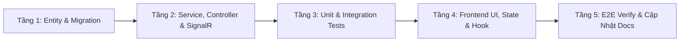

# WORKFLOW: PHÁT TRIỂN TÍNH NĂNG THEO VERTICAL SLICE (BUILD VERTICAL SLICE)

> **Mục đích:** Quy trình chuẩn để phát triển tính năng mới từ Phase 1 đến Phase 4 theo lát cắt dọc nguyên khối (Vertical Slice): hoàn thiện đồng bộ DB -> BE -> Tests -> FE -> Docs.
> **Lộ trình áp dụng:** [03_REVISED_ROADMAP.md](file:///c:/Users/coc14/OneDrive/Documents/GitHub/Project_3/docs/audit_and_plan/03_REVISED_ROADMAP.md)

---

## QUY TRÌNH 5 BƯỚC NGUYÊN KHỐI (THE 5-STEP SLICE)



### Bước 1: Entity & EF Core Migration (Database Layer)
1. Thêm hoặc cập nhật C# Model trong `BE/Paperless_Meeting/Models/`.
2. Đăng ký `DbSet<T>` và cấu hình quan hệ, index, cascade delete trong `PaperlessMeetingDbContext.cs`.
3. Sinh migration chuẩn:
   ```bash
   dotnet ef migrations add Add<FeatureName> --project BE/Paperless_Meeting
   ```
4. Xác minh file migration mới sinh không chứa thao tác phá hủy dữ liệu ngoài ý muốn.

### Bước 2: Business Logic, API & Real-time (Backend Layer)
1. Định nghĩa Interface trong `BE/Paperless_Meeting/Services/Interfaces/`.
2. Tạo các DTOs yêu cầu và phản hồi trong `BE/Paperless_Meeting/DTOs/<Feature>/`.
3. Viết Service implementation trong `BE/Paperless_Meeting/Services/<Feature>/`.
4. Tạo API Controller trong `BE/Paperless_Meeting/Controllers/`:
   - Gắn đầy đủ `[Authorize]`, `[Authorize(Roles = "...")]`.
   - Bắt buộc kiểm tra IDOR (quyền tham gia cuộc họp) nếu thao tác liên quan tới tài nguyên cuộc họp.
5. Nếu có tính năng thời gian thực, bổ sung method và broadcast event trong `Hubs/MeetingHub.cs`.

### Bước 3: Kiểm Thử Tự Động (Quality Gate Layer)
1. Viết Unit Test trong `BE/Paperless_Meeting.Tests/`:
   - Kiểm tra logic tính toán, phân quyền và validation dữ liệu.
   - Kiểm tra trường hợp biên (Edge cases) và xử lý lỗi.
2. Viết Integration Test kiểm tra Controller endpoint và tương tác DbContext.
3. Chạy lệnh: `dotnet test BE/Paperless_Meeting.sln` -> Bắt buộc **100% Passed**.

### Bước 4: Giao Diện Người Dùng & Tích Hợp (Frontend Layer)
1. Tạo Component UI trong `FE/src/components/<Feature>/` hoặc Page trong `FE/src/pages/`.
2. Tích hợp API call qua Axios client trong `FE/src/utils/api.js`.
3. Xử lý đầy đủ 3 trạng thái: Loading (Skeleton) -> Empty -> Error.
4. Bọc trong `<ErrorBoundary>` nếu là màn hình phức tạp.
5. Nếu có SignalR: Đăng ký lắng nghe event và cleanup listener đúng vòng đời `useEffect`.

### Bước 5: Xác Minh Toàn Luồng & Cập Nhật Tài Liệu
1. Chạy `npm run build` ở FE và `dotnet build` ở BE đảm bảo không có cảnh báo/lỗi.
2. Kích hoạt workflow `sync-project-docs.md` để cập nhật trạng thái tiến độ vào `docs/audit_and_plan/`.
