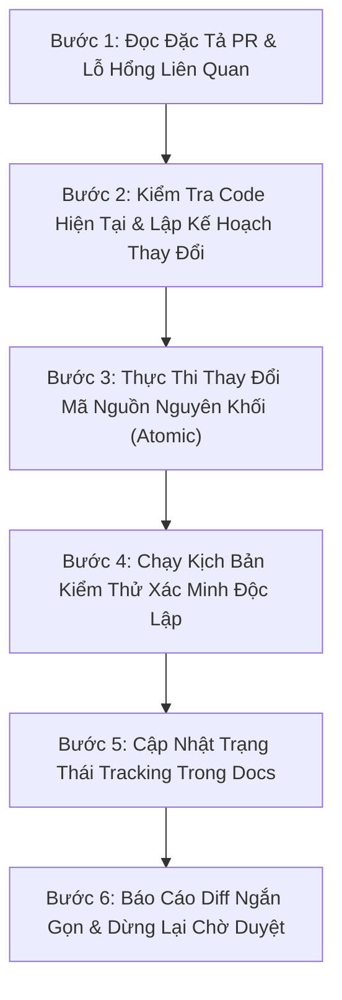

# WORKFLOW: THỰC THI PULL REQUEST GIAI ĐOẠN 0 (EXECUTE PHASE 0 PR)

> **Mục đích:** Quy trình thao tác chuẩn (SOP) để thực thi từng gói Pull Request trong Phase 0 một cách độc lập, an toàn và có kiểm thử xác minh.
> **Tài liệu tham chiếu chính:** [04_EXECUTION_PLAYBOOK.md](file:///c:/Users/coc14/OneDrive/Documents/GitHub/Project_3/docs/audit_and_plan/04_EXECUTION_PLAYBOOK.md)

---

## CÁC BƯỚC THỰC HIỆN BẮT BUỘC (STEP-BY-STEP SOP)

### Bước 1: Đọc Đặc Tả PR & Lỗ Hổng Liên Quan
- Mở [04_EXECUTION_PLAYBOOK.md](file:///c:/Users/coc14/OneDrive/Documents/GitHub/Project_3/docs/audit_and_plan/04_EXECUTION_PLAYBOOK.md) để đọc đúng mục tiêu, danh sách tệp tin tác động và kịch bản test của PR đang làm:
  - `PR-01`: Secrets Revocation, Close Public Admin & Git Hardening.
  - `PR-02`: Docker Compose, Mount Uploads Volume & Nginx WebSocket Proxy.
  - `PR-03`: Fix IDOR Document Download, Add Participant & Meeting Access Control.
  - `PR-04`: EF Core Migrations InitialCreate, Anti-Double Voting & Transactions.
  - `PR-05`: Fix MeetingLobby Crash, ErrorBoundary & Status Enum Contract Sync.
  - `PR-06`: Isolate LiveClock Re-render, Axios Refresh Token & WebRTC Cleanup.
  - `PR-07`: Build Foundation Test Suite `Paperless_Meeting.Tests` (xUnit).
- Đối chiếu các mã lỗi liên quan trong [01_SYSTEM_AUDIT_REPORT.md](file:///c:/Users/coc14/OneDrive/Documents/GitHub/Project_3/docs/audit_and_plan/01_SYSTEM_AUDIT_REPORT.md).

### Bước 2: Kiểm Tra Code Hiện Tại & Lập Kế Hoạch Thay Đổi
- Dùng `read_file` kiểm tra nội dung thực tế của các file cần sửa.
- Không sửa bất kỳ file nào nằm ngoài phạm vi danh sách tệp tin được chỉ định cho PR đó.

### Bước 3: Thực Thi Thay Đổi Mã Nguồn Nguyên Khối (Atomic Changes)
- Áp dụng các thay đổi bằng `edit_file` hoặc `write_file`.
- Tuân thủ nghiêm ngặt các quy tắc trong `.agent/rules/`:
  - Không hardcode secrets ([01-security-guardrails.md](file:///c:/Users/coc14/OneDrive/Documents/GitHub/Project_3/.agent/rules/01-security-guardrails.md)).
  - Tuân thủ chuẩn BE / FE / Infra tương ứng ([02-backend-dotnet-standards.md](file:///c:/Users/coc14/OneDrive/Documents/GitHub/Project_3/.agent/rules/02-backend-dotnet-standards.md), [03-frontend-react-standards.md](file:///c:/Users/coc14/OneDrive/Documents/GitHub/Project_3/.agent/rules/03-frontend-react-standards.md), [04-infra-docker-nginx.md](file:///c:/Users/coc14/OneDrive/Documents/GitHub/Project_3/.agent/rules/04-infra-docker-nginx.md)).

### Bước 4: Chạy Kịch Bản Kiểm Thử Xác Minh Độc Lập
- Chạy lệnh build hoặc test tương ứng qua `run_command`:
  - BE: `dotnet build BE/Paperless_Meeting/Paperless_Meeting.csproj` và `dotnet test BE/Paperless_Meeting.sln`.
  - FE: `npm --prefix FE run build` hoặc `npm --prefix FE run lint`.
  - Docker: `docker compose config` hoặc `docker compose build`.
- Đảm bảo **0 errors, 0 regressions** trước khi sang bước tiếp theo.

### Bước 5: Cập Nhật Trạng Thái Tracking Trong Docs
- Mở [03_REVISED_ROADMAP.md](file:///c:/Users/coc14/OneDrive/Documents/GitHub/Project_3/docs/audit_and_plan/03_REVISED_ROADMAP.md) và [04_EXECUTION_PLAYBOOK.md](file:///c:/Users/coc14/OneDrive/Documents/GitHub/Project_3/docs/audit_and_plan/04_EXECUTION_PLAYBOOK.md), đánh dấu `[x]` cho các task đã hoàn thành.

### Bước 6: Báo Cáo Diff Ngắn Gọn & Dừng Lại Chờ Duyệt (Human-in-the-Loop)
- Tóm tắt cho Tech Lead:
  1. Các file đã thay đổi và tóm tắt diff cốt lõi.
  2. Kết quả chạy test xác minh.
- **DỪNG LẠI** và chờ Tech Lead review và bấm duyệt trước khi kích hoạt PR tiếp theo.
