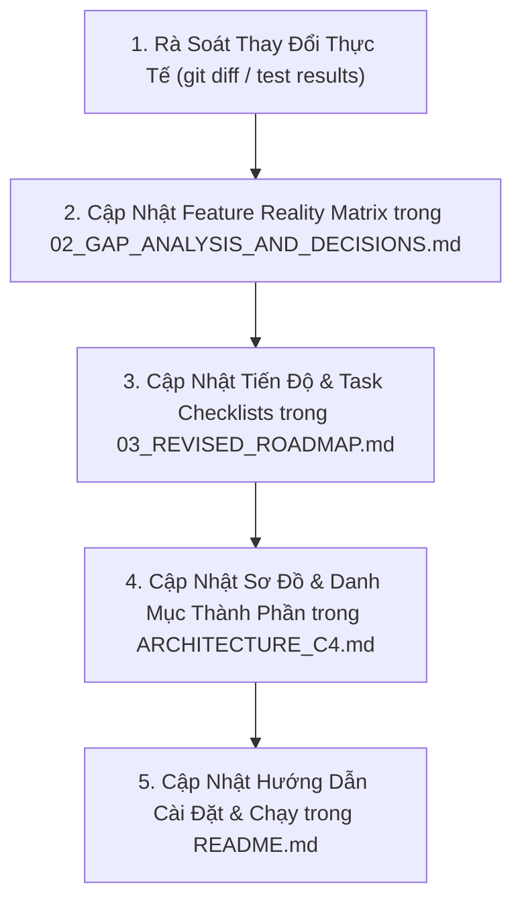

# WORKFLOW: ĐỒNG BỘ TÀI LIỆU DỰ ÁN (SYNC PROJECT DOCS)

> **Mục đích:** Quy trình chuẩn để giữ cho tài liệu thiết kế (`ARCHITECTURE_C4.md`, `README.md`) và báo cáo tiến độ trong `docs/audit_and_plan/` luôn phản ánh 100% sự thật mã nguồn sau mỗi đợt bàn giao lớn.
> **Nguyên tắc cốt tử:** Code is the Source of Truth. Tài liệu phải bám sát code, không vẽ vời tính năng chưa làm.

---

## CÁC BƯỚC ĐỒNG BỘ BẮT BUỘC (SYNC STEPS)

### Bước 1: Rà Soát Thay Đổi Thực Tế
- Kiểm tra danh sách commit và file đã chỉnh sửa bằng `git status` hoặc `git diff`.
- Xác định rõ tính năng nào đã hoàn thành đầy đủ cả DB + BE + FE + Tests.

### Bước 2: Cập Nhật Feature Reality Matrix
- Mở [02_GAP_ANALYSIS_AND_DECISIONS.md](file:///c:/Users/coc14/OneDrive/Documents/GitHub/Project_3/docs/audit_and_plan/02_GAP_ANALYSIS_AND_DECISIONS.md#2-bảng-ma-trận-tính-năng-thực-tế-feature-reality-matrix).
- Cập nhật cột **Trạng thái thực tế** và **% Hoàn thành** cho tính năng vừa làm:
  - Nâng từ `Chưa làm` hoặc `Có BE chưa có FE` lên `Hoạt động một phần` hoặc `Hoàn thiện`.
  - Cập nhật chính xác cột **Dẫn chứng mã nguồn (File:Line)**.
  - Tính toán lại phần trăm tiến độ thực tế tổng thể của dự án.

### Bước 3: Cập Nhật Lộ Trình Phát Triển (Roadmap)
- Mở [03_REVISED_ROADMAP.md](file:///c:/Users/coc14/OneDrive/Documents/GitHub/Project_3/docs/audit_and_plan/03_REVISED_ROADMAP.md).
- Đánh dấu `[x]` vào các checklist tasks đã nghiệm thu thành công.
- Nếu có phát sinh nợ kỹ thuật mới, ghi chú thêm vào phần rủi ro của Phase hiện tại.

### Bước 4: Đồng Bộ Hóa Kiến Trúc Mục Tiêu C4 (`ARCHITECTURE_C4.md`)
- Mở [BE/ARCHITECTURE_C4.md](file:///c:/Users/coc14/OneDrive/Documents/GitHub/Project_3/BE/ARCHITECTURE_C4.md).
- Cập nhật lại sơ đồ Container / Component C4 nếu có thêm Controller, Service, Hub methods, hoặc bảng dữ liệu mới.
- Xóa bỏ các mô tả sai lệch cũ (ví dụ: các mô tả về pseudo-repository hay API chưa từng tồn tại).

### Bước 5: Cập Nhật `README.md`
- Mở [README.md](file:///c:/Users/coc14/OneDrive/Documents/GitHub/Project_3/README.md).
- Đảm bảo hướng dẫn chạy Docker Compose, các biến môi trường mẫu trong `.env.example`, và lệnh chạy test `dotnet test` được mô tả chính xác, dễ hiểu cho lập trình viên mới.
