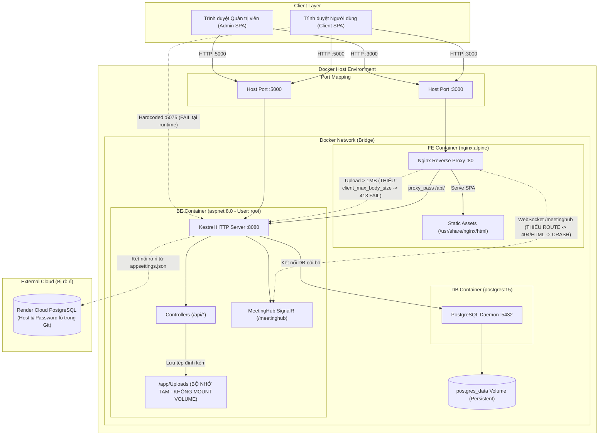
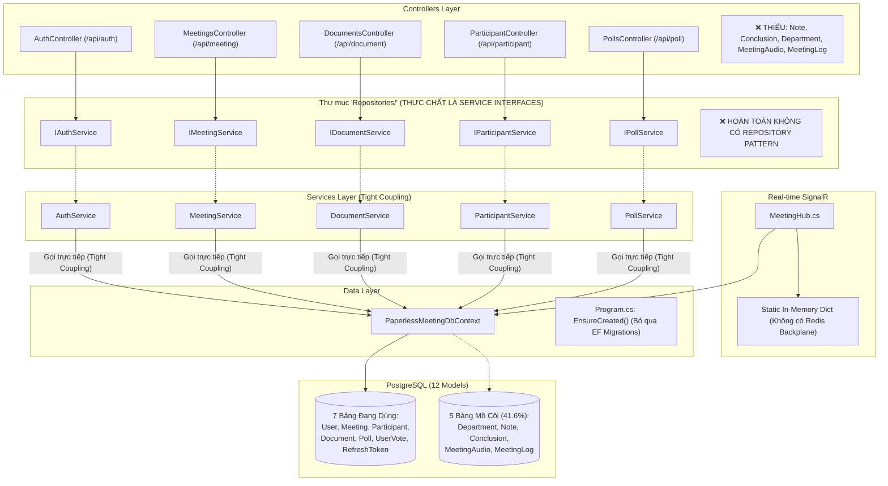
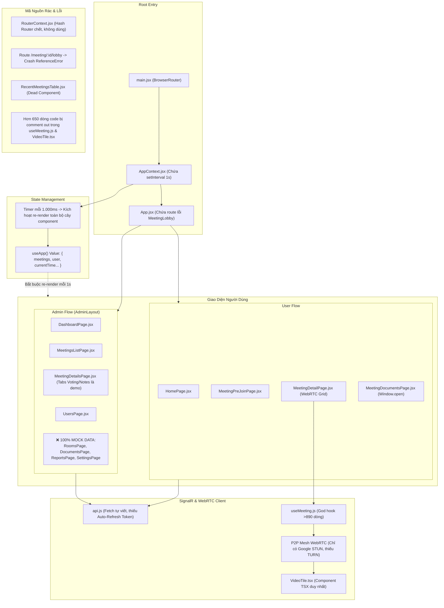

# BÁO CÁO KIỂM TOÁN HỆ THỐNG TOÀN DIỆN (SYSTEM AUDIT REPORT)
**Dự án:** Paperless Meeting System (`Project_3`)  
**Ngày thực hiện:** 21/11/2026  
**Vai trò:** Lead Systems Architect & Orchestrator  
**Phương pháp:** Read-Only Audit, Code is the Source of Truth, Subagent-driven Parallel Verification  
**Trạng thái hệ thống:** 🔴 **CRITICAL RISK - KHÔNG THỂ TRIỂN KHAI PRODUCTION**

---

## 1. TỔNG QUAN TÌNH TRẠNG DỰ ÁN (EXECUTIVE SUMMARY)

Dự án **Paperless Meeting** được xây dựng trên stack: **React 18 / Vite / Tailwind CSS**, **ASP.NET Core 8 Web API / EF Core 8 / PostgreSQL**, **SignalR**, và triển khai qua **Docker / Nginx**.

Qua kiểm toán độc lập 4 góc độ (Backend, Frontend, DevOps & Security, Product Gap), dự án hiện tại đang ở tình trạng **nghiêm trọng**:
- **Tiến độ thực tế:** Chỉ đạt khoảng **25.7%** so với mục tiêu đặt ra trong `PLAN.md` và `ARCHITECTURE_C4.md`.
- **An toàn thông tin:** Ở mức **Báo động Đỏ** với **11 lỗ hổng P0-Critical** (Lộ credential database Cloud production thật trên Git, lộ JWT Secret Key, endpoint tạo Admin công khai không cần auth, phơi bày toàn bộ tài liệu mật ra ngoài Internet, lỗ hổng IDOR tải tài liệu và lỗi sập runtime).
- **Hạ tầng & Vận hành:** Docker Compose không thể build được (`stat ./FE/FE: no such file or directory`), không mount volume tài liệu (mất trắng file khi container khởi động lại), Nginx chặn WebSocket SignalR và chặn upload file > 1MB.
- **Kiến trúc & Nghiệp vụ:** Bị chia cắt giữa 2 mục tiêu mâu thuẫn (Zoom clone vs Quản lý phòng họp thông minh). 5/12 Entity cốt lõi (41.6%) bị bỏ hoang hoàn toàn; các màn hình Admin chủ yếu là Mock Data tĩnh; 0% Automated Tests.

### Bảng Điểm Đánh Giá Sức Khỏe Hệ Thống (Health Scorecard)
| Trụ cột kiểm toán | Điểm số (0-100) | Đánh giá | Rủi ro chính |
| :--- | :---: | :---: | :--- |
| **Bảo mật & Phân quyền (Security & Auth)** | **15/100** | 🔴 Nguy cấp | Lộ DB Render, lộ JWT Key, Public Admin Register, Static file leak, IDOR khắp nơi |
| **Hạ tầng & DevOps (Docker, Nginx, CI/CD)** | **25/100** | 🔴 Nguy cấp | Docker build fail, mất dữ liệu file upload, sập SignalR qua Nginx, container chạy root |
| **Kiến trúc Backend & Database** | **40/100** | 🟠 Báo động | Pseudo-Repository, 5/12 orphan models, mất đồng bộ SQL vs C#, thiếu Transaction |
| **Frontend Architecture & UX** | **35/100** | 🟠 Báo động | Crash runtime MeetingLobby, timer re-render 1s, văng app khi F5, thiếu Auto-refresh token |
| **Tính năng & Nghiệp vụ (Product Delivery)** | **25.7/100** | 🔴 Thiếu hụt | 50% tính năng là Mock UI hoặc mới có DB, WebRTC Mesh nghẽn mạng và thiếu TURN |
| **Kiểm thử tự động (Testing & QA)** | **0/100** | 🔴 Tê liệt | 0% Unit Test, 0% Integration Test, 0% E2E Test |

---

## 2. SƠ ĐỒ KIẾN TRÚC THỰC TẾ (ARCHITECTURE REALITY)

Tài liệu `ARCHITECTURE_C4.md` hiện tại **lệch pha nghiêm trọng** so với hiện trạng source code. Dưới đây là các sơ đồ kiến trúc thực tế được vẽ lại chính xác dựa trên mã nguồn:

### 2.1 Sơ đồ Hạ tầng & Mạng Docker Thực tế


### 2.2 Sơ đồ Kiến trúc Backend Thực tế (Lệch pha C4)


### 2.3 Sơ đồ Kiến trúc Frontend Thực tế


---

## 3. DANH MỤC ĐIỂM YẾU, LỖ HỔNG VÀ NỢ KỸ THUẬT (P0 -> P3)

Toàn bộ các phát hiện được phân loại nghiêm ngặt theo 4 mức độ:
- **P0 - Critical:** Lỗ hổng bảo mật cấp bách hoặc lỗi làm sập toàn bộ hệ thống/build/chức năng cốt lõi.
- **P1 - High:** Lỗ hổng phân quyền, mất tính sẵn sàng, rò rỉ dữ liệu hoặc sai lệch logic nghiệp vụ lớn.
- **P2 - Medium:** Nợ kỹ thuật kiến trúc, vi phạm best practices, thiếu đồng bộ, ảnh hưởng mở rộng.
- **P3 - Low:** Tối ưu hóa hiệu năng nhỏ, dọn dẹp mã nguồn rác, hoàn thiện testing.

---

### 🔴 NHÓM P0 - CRITICAL (11 LỖ HỔNG NGUY HIỂM TỐI CAO)

#### 1. [P0-SEC-01] Lộ Thông Tin Xác Thực Database PostgreSQL Render Cloud Trong Git
- **Vấn đề:** Chuỗi kết nối trực tiếp đến database PostgreSQL thật trên cloud Render chứa host, port, database name, username và password plaintext được commit công khai vào Git repository.
- **Dẫn chứng:** [BE/Paperless_Meeting/appsettings.json:10-12](file:///c:/Users/coc14/OneDrive/Documents/GitHub/Project_3/BE/Paperless_Meeting/appsettings.json#L10-L12)
  ```json
  "DefaultConnection": "Host=dpg-d53qrgv5r7bs73e0jeig-a.singapore-postgres.render.com;Port=5432;Database=project3db_2gq6;Username=project3db_2gq6_user;Password=Edfm1iYVLcQGrjyBMZdprzS6iO4LbNwM;SSL Mode=Require;Trust Server Certificate=true"
  ```
- **Ảnh hưởng thực tế:** Bất kỳ ai có quyền truy cập repo đều có thể kết nối vào DB Render, đọc trộm, chỉnh sửa hoặc xóa sạch toàn bộ dữ liệu cuộc họp công ty (Ransomware risk).
- **Hướng khắc phục cụ thể:**
  1. Truy cập Render Dashboard, tiến hành rotate password hoặc revoke DB instance `dpg-d53qrgv5r7bs73e0jeig-a` ngay lập tức.
  2. Dùng BFG Repo-Cleaner hoặc `git-filter-repo` để xóa triệt để chuỗi này khỏi toàn bộ lịch sử Git commits.
  3. Chuyển cấu hình sang biến môi trường `ConnectionStrings__DefaultConnection` trong Docker/Kubernetes.

#### 2. [P0-SEC-02] Khóa Ký JWT Secret Key Bị Lưu Cứng Dạng Plaintext Trong Git
- **Vấn đề:** Khóa bí mật đối xứng ký JWT Token được hardcode trực tiếp trong mã nguồn.
- **Dẫn chứng:** [BE/Paperless_Meeting/appsettings.json:13-17](file:///c:/Users/coc14/OneDrive/Documents/GitHub/Project_3/BE/Paperless_Meeting/appsettings.json#L13-L17)
  ```json
  "Jwt": {
    "Key": "THIS IS A SUPER SECRET KEY FOR JWT TOKEN GENERATION",
    "Issuer": "https://yourdomain.com",
    "Audience": "https://yourdomain.com"
  }
  ```
- **Ảnh hưởng thực tế:** Kẻ tấn công có thể tự sinh token hợp lệ cho bất kỳ User ID nào với Role `Admin` mà không cần tài khoản hay mật khẩu, chiếm đoạt toàn quyền hệ thống.
- **Hướng khắc phục cụ thể:**
  1. Sinh khóa ngẫu nhiên chuẩn 256-bit Base64 và đưa vào file `.env` (không commit git).
  2. Đọc khóa qua biến môi trường `Jwt__Key`.

#### 3. [P0-SEC-03] Endpoint Đăng Ký Tài Khoản Admin Hoàn Toàn Public (Privilege Escalation)
- **Vấn đề:** Controller cung cấp API đăng ký tài khoản Quản trị viên (`/api/Auth/register/admin`) nhưng không có attribute `[Authorize]`.
- **Dẫn chứng:** [BE/Paperless_Meeting/Controllers/Auth/AuthController.cs:32-43](file:///c:/Users/coc14/OneDrive/Documents/GitHub/Project_3/BE/Paperless_Meeting/Controllers/Auth/AuthController.cs#L32-L43)
  ```csharp
  [HttpPost("register/admin")]
  public async Task<IActionResult> RegisterAdmin(RegisterRequestDto registerDto)
  ```
- **Ảnh hưởng thực tế:** Bất kỳ người dùng nặc danh nào trên Internet đều có thể gửi HTTP POST để tạo một tài khoản Admin mới cho chính mình.
- **Hướng khắc phục cụ thể:**
  Thêm attribute `[Authorize(Roles = "SuperAdmin")]` hoặc đóng hoàn toàn endpoint này trên môi trường Production, chỉ seed Admin qua Migration ban đầu.

#### 4. [P0-SEC-04] Phơi Bày Toàn Bộ Thư Mục Tài Liệu Mật Ra Public Internet
- **Vấn đề:** `Program.cs` cấu hình static file server map trực tiếp thư mục `Uploads` ra route `/files` không cần bất kỳ xác thực nào, kèm `ServeUnknownFileTypes = true`.
- **Dẫn chứng:** [BE/Paperless_Meeting/Program.cs:178-189](file:///c:/Users/coc14/OneDrive/Documents/GitHub/Project_3/BE/Paperless_Meeting/Program.cs#L178-L189)
  ```csharp
  app.UseStaticFiles(new StaticFileOptions
  {
      FileProvider = new PhysicalFileProvider(uploadPath),
      RequestPath = "/files",
      ServeUnknownFileTypes = true
  });
  ```
- **Ảnh hưởng thực tế:** Mọi tài liệu mật, báo cáo tài chính, file upload nội bộ đều có thể bị tải về nặc danh nếu đoán được tên file hoặc duyệt qua thư mục. Đồng thời mở toang nguy cơ Stored XSS nếu user upload file HTML/SVG.
- **Hướng khắc phục cụ thể:**
  Xóa bỏ hoàn toàn khối `app.UseStaticFiles` trỏ vào `Uploads`. Mọi thao tác tải file bắt buộc phải đi qua `DocumentsController.DownloadDocument` có kiểm tra JWT và quyền tham gia cuộc họp.

#### 5. [P0-INFRA-01] Docker Compose Sai Đường Dẫn Build Frontend Làm Sập Triển Khai
- **Vấn đề:** `docker-compose.yml` trỏ ngữ cảnh build frontend vào thư mục `./FE/FE` (không tồn tại).
- **Dẫn chứng:** [docker-compose.yml:28-30](file:///c:/Users/coc14/OneDrive/Documents/GitHub/Project_3/docker-compose.yml#L28-L30)
  ```yaml
  frontend:
    build: ./FE/FE
  ```
- **Ảnh hưởng thực tế:** Chạy lệnh `docker compose up --build` lập tức gặp lỗi `stat ./FE/FE: no such file or directory` và crash tiến trình triển khai.
- **Hướng khắc phục cụ thể:**
  Sửa đường dẫn thành `build: ./FE`.

#### 6. [P0-INFRA-02] Thiếu Docker Volume Gây Mất Trắng Toàn Bộ Tài Liệu Khi Restart Container
- **Vấn đề:** Service `backend` trong `docker-compose.yml` không hề mount volume cho thư mục `/app/Uploads`.
- **Dẫn chứng:** [docker-compose.yml:16-27](file:///c:/Users/coc14/OneDrive/Documents/GitHub/Project_3/docker-compose.yml#L16-L27)
- **Ảnh hưởng thực tế:** Khi container backend bị khởi động lại, nâng cấp image hoặc restart, toàn bộ tài liệu đính kèm cuộc họp và file âm thanh người dùng đã tải lên sẽ bị xóa sạch vĩnh viễn khỏi filesystem của container.
- **Hướng khắc phục cụ thể:**
  Bổ sung named volume trong `docker-compose.yml`:
  ```yaml
  services:
    backend:
      volumes:
        - backend_uploads:/app/Uploads
  volumes:
    backend_uploads:
  ```

#### 7. [P0-SEC-05] Lỗ Hổng IDOR Cho Phép Tải Trộm Bất Kỳ Tài Liệu Cuộc Họp Nào
- **Vấn đề:** Endpoint `DownloadDocument` chỉ nhận `documentId`, tìm file trên đĩa và trả về mà không hề kiểm tra xem `userId` hiện tại có phải là người tham dự (Participant) của cuộc họp chứa tài liệu đó hay không.
- **Dẫn chứng:** [BE/Paperless_Meeting/Controllers/Meeting/DocumentsController.cs:192-227](file:///c:/Users/coc14/OneDrive/Documents/GitHub/Project_3/BE/Paperless_Meeting/Controllers/Meeting/DocumentsController.cs#L192-L227)
- **Ảnh hưởng thực tế:** Một nhân viên bất kỳ chỉ cần đăng nhập là có thể thay đổi `documentId` (1, 2, 3...) để tải về toàn bộ tài liệu cơ mật của các cuộc họp hội đồng quản trị/lãnh đạo mà mình không được mời tham dự.
- **Hướng khắc phục cụ thể:**
  Trích xuất `userId` từ JWT claims, kiểm tra quan hệ `MeetingParticipant` giữa `userId` và `document.MeetingId`. Nếu không thuộc cuộc họp, trả về `403 Forbidden`.

#### 8. [P0-FE-01] Crash Ứng Dụng Runtime (White Screen) Do Tham Chiếu Component Không Tồn Tại
- **Vấn đề:** Route `/meeting/:meetingId/lobby` render component `<MeetingLobby />` nhưng component này không hề được import và không tồn tại trong codebase.
- **Dẫn chứng:** [FE/src/App.jsx:33](file:///c:/Users/coc14/OneDrive/Documents/GitHub/Project_3/FE/src/App.jsx#L33) và [FE/src/pages/admin/MeetingDetailsPage.jsx:111](file:///c:/Users/coc14/OneDrive/Documents/GitHub/Project_3/FE/src/pages/admin/MeetingDetailsPage.jsx#L111).
- **Ảnh hưởng thực tế:** Khi quản trị viên bấm nút "Join Meeting" từ trang chi tiết cuộc họp Admin, React ném ngoại lệ `ReferenceError: MeetingLobby is not defined`. Toàn bộ ứng dụng sập và hiển thị màn hình trắng.
- **Hướng khắc phục cụ thể:**
  Xóa route `/meeting/:meetingId/lobby` và sửa nút điều hướng trỏ về `/meeting/:meetingId/prejoin`.

#### 9. [P0-FE-02] Lệch Contract Status Enum Làm Tê Liệt Toàn Bộ Bộ Lọc Cuộc Họp FE
- **Vấn đề:** BE trả về trường `Status` dạng chuỗi PascalCase (`"Scheduled"`, `"Ongoing"`, `"Completed"`). Nhưng FE mapping:
  `status: ['not_started', 'ongoing', 'completed', 'postponed'][m.status] || 'not_started'`.
  Vì `m.status` là chuỗi `"Scheduled"`, truy cập array theo string index luôn trả về `undefined` và fallback về `'not_started'`.
- **Dẫn chứng:** [FE/src/contexts/AppContext.jsx:56](file:///c:/Users/coc14/OneDrive/Documents/GitHub/Project_3/FE/src/contexts/AppContext.jsx#L56).
- **Ảnh hưởng thực tế:** Toàn bộ cuộc họp trên giao diện người dùng vĩnh viễn hiển thị ở trạng thái "Chưa bắt đầu". Các tab "Đang diễn ra" và "Đã kết thúc" luôn luôn trống rỗng (empty).
- **Hướng khắc phục cụ thể:**
  Xây dựng hàm chuẩn hóa Contract Status chung giữa BE và FE dựa trên chuỗi status trả về.

#### 10. [P0-FE-03] Hardcode SignalR Hub URL Làm Mất Kết Nối WebSocket Khi Triển Khai
- **Vấn đề:** SignalR hub connection ở FE bị hardcode cứng địa chỉ dev `http://localhost:5075/meetinghub` và Nginx hoàn toàn không có cấu hình proxy route cho `/meetinghub`.
- **Dẫn chứng:** [FE/src/hook/useMeeting.js:697](file:///c:/Users/coc14/OneDrive/Documents/GitHub/Project_3/FE/src/hook/useMeeting.js#L697) và [FE/nginx.conf:1-17](file:///c:/Users/coc14/OneDrive/Documents/GitHub/Project_3/FE/nginx.conf#L1-L17).
- **Ảnh hưởng thực tế:** Khi chạy qua Docker (port 3000) hoặc deploy production, SignalR không thể kết nối tới port 5075 của client. WebSocket handshake thất bại 100%, tê liệt toàn bộ tính năng họp video, biểu quyết realtime và trao đổi tín hiệu.
- **Hướng khắc phục cụ thể:**
  1. Đổi Hub URL ở FE thành đường dẫn tương đối `/meetinghub`.
  2. Thêm route proxy WebSocket `/meetinghub` với các header `Upgrade` và `Connection` trong `FE/nginx.conf`.

#### 11. [P0-FE-04] Thiếu Hoàn Toàn Error Boundary Gây Trắng Trang (White Screen of Death)
- **Vấn đề:** Ứng dụng React 18 không được bọc bởi bất kỳ Error Boundary nào từ gốc `main.jsx` cho tới các trang con.
- **Dẫn chứng:** [FE/src/main.jsx:1-14](file:///c:/Users/coc14/OneDrive/Documents/GitHub/Project_3/FE/src/main.jsx#L1-L14) và [FE/src/App.jsx:1-70](file:///c:/Users/coc14/OneDrive/Documents/GitHub/Project_3/FE/src/App.jsx#L1-L70).
- **Ảnh hưởng thực tế:** Bất kỳ lỗi runtime rendering nhỏ nào (như dữ liệu API trả về thiếu trường, null pointer) đều khiến React unmount toàn bộ cây DOM, người dùng bị văng ra màn hình trắng xóa mà không có thông báo lỗi hay nút khôi phục.
- **Hướng khắc phục cụ thể:**
  Tạo component `ErrorBoundary.jsx` chuẩn và bọc quanh `<AppContent />` trong `main.jsx`.

---

### 🟠 NHÓM P1 - HIGH (18 VẤN ĐỀ NGHIÊM TRỌNG VỀ PHÂN QUYỀN, VẬN HÀNH & LOGIC)

#### 1. [P1-SEC-01] IDOR Tại Endpoint Thêm Thành Viên (`AddParticipant`)
- **Dẫn chứng:** [BE/Paperless_Meeting/Controllers/Meeting/ParticipantController.cs:60-87](file:///c:/Users/coc14/OneDrive/Documents/GitHub/Project_3/BE/Paperless_Meeting/Controllers/Meeting/ParticipantController.cs#L60-L87).
- **Tác động:** Endpoint `AddParticipant` đơn lẻ bị lập trình viên bỏ quên kiểm tra quyền (khác với `AddMultipleParticipants`), cho phép bất kỳ user nào cũng có thể tự thêm chính mình hoặc bất kỳ ai vào cuộc họp kín của công ty.
- **Khắc phục:** Bổ sung kiểm tra `await IsHostOfMeetingAsync(meetingId, currentUserId)`.

#### 2. [P1-SEC-02] Broken Access Control Tại `GetAllMeetings` và `GetMeetingById`
- **Dẫn chứng:** [BE/Paperless_Meeting/Controllers/Meeting/MeetingsController.cs:26-31, 46-53](file:///c:/Users/coc14/OneDrive/Documents/GitHub/Project_3/BE/Paperless_Meeting/Controllers/Meeting/MeetingsController.cs#L26-L31).
- **Tác động:** `GetAllMeetings` trả về toàn bộ danh sách cuộc họp của tất cả phòng ban trong công ty cho bất kỳ ai có token. `GetMeetingById` không kiểm tra tư cách thành viên, để lộ lịch trình nội bộ và thông tin nhạy cảm.
- **Khắc phục:** `GetAllMeetings` chỉ cho phép Admin; User thường chỉ được lấy danh sách cuộc họp mà mình là Host hoặc Participant (`GetMyMeetings`).

#### 3. [P1-CONCURRENCY-01] Double Voting Do TOCTOU Race Condition & Thiếu Unique Index
- **Dẫn chứng:** [BE/Paperless_Meeting/Controllers/Meeting/PollsController.cs:105-111](file:///c:/Users/coc14/OneDrive/Documents/GitHub/Project_3/BE/Paperless_Meeting/Controllers/Meeting/PollsController.cs#L105-L111) và [BE/Paperless_Meeting/Models/UserVote.cs:6-26](file:///c:/Users/coc14/OneDrive/Documents/GitHub/Project_3/BE/Paperless_Meeting/Models/UserVote.cs#L6-L26).
- **Tác động:** Hàm `HasUserVotedAsync` kiểm tra xong mới gọi `SubmitVoteAsync` (Time-of-Check to Time-of-Use). Bảng `UserVotes` lại không có ràng buộc Unique Constraint `(PollId, UserId)`. Khi cử tri click nhanh hoặc gửi request song song, họ có thể bỏ phiếu nhiều lần, làm sai lệch kết quả biểu quyết.
- **Khắc phục:** Cấu hình Unique Index trong `DbContext`: `modelBuilder.Entity<UserVote>().HasIndex(uv => new { uv.PollId, uv.UserId }).IsUnique();`.

#### 4. [P1-DATA-01] Thiếu Database Transaction Khi Tạo Cuộc Họp
- **Dẫn chứng:** [BE/Paperless_Meeting/Services/Meeting/MeetingService.cs:74-87](file:///c:/Users/coc14/OneDrive/Documents/GitHub/Project_3/BE/Paperless_Meeting/Services/Meeting/MeetingService.cs#L74-L87).
- **Tác động:** `CreateMeetingAsync` gọi `SaveChangesAsync` lần 1 để lưu `Meeting`, sau đó mới add Host vào `MeetingParticipants` và gọi `SaveChangesAsync` lần 2 mà không bọc trong Database Transaction. Nếu bước 2 lỗi, cuộc họp bị tạo dở dang và mồ côi (không có Host).
- **Khắc phục:** Bọc logic tạo cuộc họp trong `await using var transaction = await _context.Database.BeginTransactionAsync()`.

#### 5. [P1-FILE-01] Unrestricted File Upload Thiếu Whitelist Định Dạng & Magic Bytes
- **Dẫn chứng:** [BE/Paperless_Meeting/Services/Document/DocumentService.cs:47-66](file:///c:/Users/coc14/OneDrive/Documents/GitHub/Project_3/BE/Paperless_Meeting/Services/Document/DocumentService.cs#L47-L66).
- **Tác động:** Hệ thống chỉ kiểm tra phần mở rộng file do client tự khai báo, không kiểm tra Magic Bytes (File Signature). Kẻ tấn công có thể đổi đuôi file `.exe`, `.sh`, `.html` thành `.pdf` để tải lên máy chủ, gây nguy cơ thực thi mã độc hoặc Stored XSS.
- **Khắc phục:** Áp dụng Whitelist extension (`.pdf`, `.docx`, `.xlsx`, `.pptx`, `.png`, `.jpg`) và kiểm tra Magic Bytes ở header của file stream.

#### 6. [P1-INFRA-01] Nginx Thiếu `client_max_body_size` Gây Lỗi 413 Khi Upload
- **Dẫn chứng:** [FE/nginx.conf:1-17](file:///c:/Users/coc14/OneDrive/Documents/GitHub/Project_3/FE/nginx.conf#L1-L17).
- **Tác động:** Nginx mặc định giới hạn body size là **1MB**. Trong khi backend cho phép tới 500MB ([Program.cs:70](file:///c:/Users/coc14/OneDrive/Documents/GitHub/Project_3/BE/Paperless_Meeting/Program.cs#L70)). Mọi file tài liệu thuyết trình hoặc ghi âm > 1MB khi upload qua Nginx đều bị chặn đứng với mã lỗi `HTTP 413 Request Entity Too Large`.
- **Khắc phục:** Thêm `client_max_body_size 500M;` vào block `server` trong `FE/nginx.conf`.

#### 7. [P1-INFRA-02] Sai Lệch Cơ Chế Biến Môi Trường Vite Giữa Build-time và Runtime
- **Dẫn chứng:** [FE/src/utils/api.js:2](file:///c:/Users/coc14/OneDrive/Documents/GitHub/Project_3/FE/src/utils/api.js#L2) và [docker-compose.yml:33](file:///c:/Users/coc14/OneDrive/Documents/GitHub/Project_3/docker-compose.yml#L33).
- **Tác động:** Vite chỉ nạp biến `VITE_*` tại thời điểm chạy build. `docker-compose.yml` lại truyền `REACT_APP_API_URL=http://backend:5000/api` tại runtime container. Hậu quả là biến này bị bỏ qua hoàn toàn, FE luôn fallback về `localhost:5075`.
- **Khắc phục:** Chuẩn hóa Nginx reverse proxy: FE gọi API theo đường dẫn tương đối `/api` và Hub tương đối `/meetinghub`.

#### 8. [P1-INFRA-03] Thiếu Hoàn Toàn File `.dockerignore` Gây Ô Nhiễm Build Context
- **Dẫn chứng:** [BE/Paperless_Meeting/Dockerfile:9](file:///c:/Users/coc14/OneDrive/Documents/GitHub/Project_3/BE/Paperless_Meeting/Dockerfile#L9) và [FE/Dockerfile:5](file:///c:/Users/coc14/OneDrive/Documents/GitHub/Project_3/FE/Dockerfile#L5).
- **Tác động:** Docker build context copy toàn bộ thư mục `obj/`, `bin/`, `node_modules/`, `.git/`, và file upload trên máy host vào trong image, làm tăng kích thước image hàng trăm MB và nguy cơ xung đột binary Windows/Linux.
- **Khắc phục:** Tạo file `.dockerignore` tại gốc, `BE/Paperless_Meeting/` và `FE/`.

#### 9. [P1-INFRA-04] Container Backend Chạy Dưới Quyền Root (Vi Phạm Đặc Quyền Tối Thiểu)
- **Dẫn chứng:** [BE/Paperless_Meeting/Dockerfile:15-20](file:///c:/Users/coc14/OneDrive/Documents/GitHub/Project_3/BE/Paperless_Meeting/Dockerfile#L15-L20).
- **Tác động:** Tiến trình Kestrel chạy với UID 0 (root). Nếu xảy ra lỗ hổng RCE hoặc Path Traversal qua upload file, kẻ tấn công có quyền root trong container và dễ dàng leo thang thoát container (container breakout).
- **Khắc phục:** Bổ sung chỉ thị `USER app` trong runtime stage của Dockerfile.

#### 10. [P1-DATA-02] Dùng `EnsureCreated()` Phá Hỏng Cơ Chế EF Core Migrations
- **Dẫn chứng:** [BE/Paperless_Meeting/Program.cs:141](file:///c:/Users/coc14/OneDrive/Documents/GitHub/Project_3/BE/Paperless_Meeting/Program.cs#L141).
- **Tác động:** `EnsureCreated()` không tạo bảng quản lý lịch sử `__EFMigrationsHistory`. Thư mục `Migrations/` không có migration file nào. Database không thể nâng cấp schema tự động khi triển khai CI/CD.
- **Khắc phục:** Tạo migration đầu tiên: `dotnet ef migrations add InitialCreate` và thay `EnsureCreated()` bằng `db.Database.Migrate()`.

#### 11. [P1-FE-01] Thiếu Auto-Refresh Token Gây Văng Khỏi Cuộc Họp Khi JWT Hết Hạn
- **Dẫn chứng:** [FE/src/utils/api.js:45-48](file:///c:/Users/coc14/OneDrive/Documents/GitHub/Project_3/FE/src/utils/api.js#L45-L48).
- **Tác động:** `api.js` dùng `fetch` thủ công. Khi gặp 401, code lập tức xóa token và gọi `window.location.href = '/login'`. Khi người dùng đang họp online mà token JWT hết hạn (15-60p), họ bị văng tức khắc ra khỏi phòng họp.
- **Khắc phục:** Sử dụng Axios Interceptor với hàng đợi request để tự động gọi `/api/Auth/refresh-token` và retry request nền mà không làm gián đoạn người dùng.

#### 12. [P1-FE-02] Bão Re-render Toàn Bộ Ứng Dụng Mỗi 1 Giây Do Root Context Timer
- **Dẫn chứng:** [FE/src/contexts/AppContext.jsx:14, 23-26, 203-223](file:///c:/Users/coc14/OneDrive/Documents/GitHub/Project_3/FE/src/contexts/AppContext.jsx#L23-L26).
- **Tác động:** State `currentTime` được cập nhật mỗi 1.000ms trong `AppContext` và đưa vào `value` mà không có `useMemo`. Mọi component sử dụng `useApp()` (Header, HomePage, MeetingDetailPage, AdminLayout...) đều bị ép re-render mỗi giây, gây giật lag video WebRTC và ngốn CPU máy trạm.
- **Khắc phục:** Tách `currentTime` ra khỏi `AppContext`. Tạo component độc lập `<LiveClock />` tự duy trì state cục bộ.

#### 13. [P1-FE-03] Rò Rỉ Kết Nối WebRTC (Memory Leak) Khi Thoát Khỏi Phòng Họp
- **Dẫn chứng:** [FE/src/hook/useMeeting.js:715-720](file:///c:/Users/coc14/OneDrive/Documents/GitHub/Project_3/FE/src/hook/useMeeting.js#L715-L720).
- **Tác động:** Trong hàm cleanup của `useEffect`, code ngắt kết nối SignalR nhưng hoàn toàn không lặp qua `peersRef.current` để gọi `pc.close()`. Các luồng media ngầm và kết nối mạng P2P vẫn tiếp tục chạy ngầm trong bộ nhớ trình duyệt.
- **Khắc phục:** Duyệt qua tất cả peer connection trong `peersRef.current`, đóng kết nối và dừng tất cả tracks của local stream.

#### 14. [P1-MEDIA-01] Thiếu Máy Chủ TURN Làm Kết Nối WebRTC Chết 100% Trên Mạng 4G/NAT
- **Dẫn chứng:** [FE/src/hook/useMeeting.js:470](file:///c:/Users/coc14/OneDrive/Documents/GitHub/Project_3/FE/src/hook/useMeeting.js#L470).
- **Tác động:** Cấu hình ICE Server chỉ có STUN công cộng của Google (`stun:stun.l.google.com:19302`). Người dùng kết nối qua mạng di động 4G (Symmetric NAT) hoặc mạng nội bộ cơ quan có tường lửa sẽ bị lỗi ICE Connection Failed 100%, không thể thấy hình/tiếng của nhau.
- **Khắc phục:** Triển khai máy chủ Coturn (STUN/TURN) và cấu hình TURN credentials trong ICE servers array.

#### 15. [P1-FE-04] Lệch Case Role Làm Ẩn Vĩnh Viễn Nút Tạo Cuộc Họp Admin Trên Trang Chủ
- **Dẫn chứng:** [FE/src/pages/HomePage.jsx:27](file:///c:/Users/coc14/OneDrive/Documents/GitHub/Project_3/FE/src/pages/HomePage.jsx#L27) và [BE/Paperless_Meeting/DTOs/Auth/LoginResponseDto.cs:7](file:///c:/Users/coc14/OneDrive/Documents/GitHub/Project_3/BE/Paperless_Meeting/DTOs/Auth/LoginResponseDto.cs#L7).
- **Tác động:** BE trả về `Role: "Admin"` (PascalCase), nhưng HomePage lại kiểm tra `currentUser?.role === 'admin'` (lowercase). Kết quả: Nút tạo cuộc họp cho Admin trên trang chủ người dùng không bao giờ xuất hiện.
- **Khắc phục:** Chuẩn hóa so sánh không phân biệt hoa thường: `currentUser?.role?.toLowerCase() === 'admin'`.

#### 16. [P1-FE-05] Bug Gán Nhầm Nội Dung Mô Tả Cuộc Họp Thành Địa Điểm
- **Dẫn chứng:** [FE/src/contexts/AppContext.jsx:155](file:///c:/Users/coc14/OneDrive/Documents/GitHub/Project_3/FE/src/contexts/AppContext.jsx#L155).
- **Tác động:** Khi tạo cuộc họp: `description: payload.location || ''`. Nội dung mô tả cuộc họp bị ghi đè hoàn toàn bởi tên phòng/địa điểm, mất sạch nội dung tóm tắt cuộc họp người dùng đã nhập.
- **Khắc phục:** Sửa thành `description: payload.description || ''`.

#### 17. [P1-FE-06] Người Dùng Bấm F5 Ở Trang Tài Liệu Bị Đẩy Văng Về Trang Chủ
- **Dẫn chứng:** [FE/src/pages/MeetingDocumentsPage.jsx:19-26](file:///c:/Users/coc14/OneDrive/Documents/GitHub/Project_3/FE/src/pages/MeetingDocumentsPage.jsx#L19-L26).
- **Tác động:** Trang tài liệu tìm thông tin cuộc họp trong mảng `meetings` của context. Khi người dùng bấm F5 (Reload), context khởi tạo lại với mảng rỗng `[]`, code tìm không thấy meeting nên lập tức kích hoạt `navigate('/')`, đẩy văng người dùng về trang chủ.
- **Khắc phục:** Nếu không có meeting trong context, gọi API `getMeetingById(meetingId)` để tải dữ liệu trước khi quyết định điều hướng.

#### 18. [P1-FE-07] Xáo Trộn Thứ Tự Route Và Lỗi Cú Pháp Ký Tự Trong `App.jsx`
- **Dẫn chứng:** [FE/src/App.jsx:54-61](file:///c:/Users/coc14/OneDrive/Documents/GitHub/Project_3/FE/src/App.jsx#L54-L61).
- **Tác động:** Route `path="*"` bị đặt TRƯỚC route tài liệu và prejoin; route `/meeting/:meetingId` bị lặp lại 2 lần; cuối dòng 59 có ký tự backslash `\` thừa gây lỗi cú pháp JSX.
- **Khắc phục:** Đưa `path="*"` xuống cuối cùng, xóa route trùng lặp và ký tự rác.

---

### 🟡 NHÓM P2 - MEDIUM (17 VẤN ĐỀ VỀ KIẾN TRÚC, NỢ KỸ THUẬT & TRẢI NGHIỆM)

1. **[P2-ARCH-01] Thư mục "Repositories/" Chứa Service Interfaces & Tight Coupling với DbContext:**
   - Dẫn chứng: [BE/Paperless_Meeting/Repositories/](file:///c:/Users/coc14/OneDrive/Documents/GitHub/Project_3/BE/Paperless_Meeting/Repositories/) và [MeetingService.cs:10-15](file:///c:/Users/coc14/OneDrive/Documents/GitHub/Project_3/BE/Paperless_Meeting/Services/Meeting/MeetingService.cs#L10-L15).
   - Tác động: Tên thư mục gây hiểu lầm, tầng Services gọi trực tiếp `PaperlessMeetingDbContext`, không thể mock database để viết Unit Test độc lập.
2. **[P2-SIGNALR-01] SignalR Stateful In-Memory Không Thể Scale-Out:**
   - Dẫn chứng: [BE/Paperless_Meeting/Hubs/MeetingHub.cs:20-23](file:///c:/Users/coc14/OneDrive/Documents/GitHub/Project_3/BE/Paperless_Meeting/Hubs/MeetingHub.cs#L20-L23).
   - Tác động: Lưu danh sách user trong `ConcurrentDictionary` tĩnh in-memory. Nếu chạy từ 2 container backend trở lên, user ở container A không thể gửi thông điệp cho user ở container B. Cần Redis Backplane.
3. **[P2-SIGNALR-02] Duplicate Broadcast Event Trong `StartScreenShare`:**
   - Dẫn chứng: [BE/Paperless_Meeting/Hubs/MeetingHub.cs:241-270](file:///c:/Users/coc14/OneDrive/Documents/GitHub/Project_3/BE/Paperless_Meeting/Hubs/MeetingHub.cs#L241-L270).
   - Tác động: Lỗi copy-paste khiến sự kiện `ScreenShareStarted` bị phát 2 lần liên tiếp tới tất cả client.
4. **[P2-SEC-01] Refresh Token Thiếu Cơ Chế Reuse Detection & Thiếu DB Index:**
   - Dẫn chứng: [BE/Paperless_Meeting/Services/Auth/AuthService.cs:123-135](file:///c:/Users/coc14/OneDrive/Documents/GitHub/Project_3/BE/Paperless_Meeting/Services/Auth/AuthService.cs#L123-L135).
   - Tác động: Không có Token Family Revocation để chống tấn công phát lại (Replay Attack); thiếu Index trên cột `Token` gây quét toàn bảng khi xác thực.
5. **[P2-PRIVACY-01] Vi Phạm Nguyên Tắc Bỏ Phiếu Kín (Secret Ballot):**
   - Dẫn chứng: [BE/Paperless_Meeting/Services/Poll/PollService.cs:146-153](file:///c:/Users/coc14/OneDrive/Documents/GitHub/Project_3/BE/Paperless_Meeting/Services/Poll/PollService.cs#L146-L153).
   - Tác động: API trả về chi tiết `UserVotes` kèm họ tên và lựa chọn của từng người, làm lộ toàn bộ thông tin bỏ phiếu kín của các đại biểu.
6. **[P2-ERR-01] Thiếu Global Exception Middleware & Bật Detailed Errors Trên Production:**
   - Dẫn chứng: [BE/Paperless_Meeting/Program.cs:73-76](file:///c:/Users/coc14/OneDrive/Documents/GitHub/Project_3/BE/Paperless_Meeting/Program.cs#L73-L76).
   - Tác động: Khi có lỗi unhandled, stack trace nội bộ (đường dẫn file C#, query database) bị lộ trực tiếp ra client qua SignalR và HTTP 500.
7. **[P2-LOG-01] Ghi Log Toàn Văn Tin Nhắn Chat & Bật LogLevel.Debug Trên Production:**
   - Dẫn chứng: [BE/Paperless_Meeting/Hubs/MeetingHub.cs:202](file:///c:/Users/coc14/OneDrive/Documents/GitHub/Project_3/BE/Paperless_Meeting/Hubs/MeetingHub.cs#L202) và [Program.cs:24-26](file:///c:/Users/coc14/OneDrive/Documents/GitHub/Project_3/BE/Paperless_Meeting/Program.cs#L24-L26).
   - Tác động: Toàn bộ nội dung trò chuyện của người dùng bị ghi plaintext ra console server, vi phạm quyền riêng tư và làm nghẽn I/O server.
8. **[P2-INFRA-01] Thiếu Toàn Bộ HTTP Security Response Headers Trên Nginx:**
   - Dẫn chứng: [FE/nginx.conf:1-17](file:///c:/Users/coc14/OneDrive/Documents/GitHub/Project_3/FE/nginx.conf#L1-L17).
   - Tác động: Thiếu `X-Frame-Options` (nguy cơ Clickjacking), thiếu `X-Content-Type-Options` (MIME sniffing), thiếu `Content-Security-Policy`.
9. **[P2-FILE-01] Xung Đột Đường Dẫn Lưu Trữ Tệp Giữa Các Tầng Code:**
   - Dẫn chứng: [DocumentService.cs:41](file:///c:/Users/coc14/OneDrive/Documents/GitHub/Project_3/BE/Paperless_Meeting/Services/Document/DocumentService.cs#L41) dùng `WebRootPath`, [DocumentsController.cs:204](file:///c:/Users/coc14/OneDrive/Documents/GitHub/Project_3/BE/Paperless_Meeting/Controllers/Meeting/DocumentsController.cs#L204) dùng `GetCurrentDirectory() + "wwwroot"`.
   - Tác động: File lưu một nơi nhưng controller tìm tải ở nơi khác, dẫn tới lỗi 404 Not Found ngẫu nhiên.
10. **[P2-GIT-01] Commit Thư Mục Binary Biên Dịch (`obj/`) và File Upload Test Vào Git:**
    - Dẫn chứng: `BE/Paperless_Meeting/obj/Debug/net8.0/` và `BE/Paperless_Meeting/Uploads/documents/4/`.
    - Tác động: Làm phình kích thước repository Git và gây xung đột build giữa các hệ điều hành.
11. **[P2-INFRA-02] Seeding Database Collision Khi Chạy Nhiều Replicas Backend:**
    - Dẫn chứng: [BE/Paperless_Meeting/Program.cs:143-165](file:///c:/Users/coc14/OneDrive/Documents/GitHub/Project_3/BE/Paperless_Meeting/Program.cs#L143-L165).
    - Tác động: Khối `if (!db.Users.Any())` không có distributed lock. Khi scale 2 replicas cùng lúc, cả 2 cùng insert seed user gây duplicate key crash.
12. **[P2-INFRA-03] Thiếu Restart Policy và Healthcheck Cho Backend Trong Docker Compose:**
    - Dẫn chứng: [docker-compose.yml:2-39](file:///c:/Users/coc14/OneDrive/Documents/GitHub/Project_3/docker-compose.yml#L2-L39).
    - Tác động: Khi backend crash không tự khởi động lại; frontend khởi động trước khi backend sẵn sàng.
13. **[P2-FE-01] Phân Mảnh Điều Hướng: Trộn Lẫn Hash Navigation Và Dead Code RouterContext:**
    - Dẫn chứng: [RouterContext.jsx:1-55](file:///c:/Users/coc14/OneDrive/Documents/GitHub/Project_3/FE/src/contexts/RouterContext.jsx#L1-L55) và `window.location.hash = ...` tại Header, Sidebar, HomePage.
    - Tác động: Phá vỡ cơ chế History của `react-router-dom`, tạo ra các URL dị tật dạng `/#/login`.
14. **[P2-FE-02] Phá Vỡ URL Deep-linking Trong `AdminLayout.jsx`:**
    - Dẫn chứng: [FE/src/pages/admin/AdminLayout.jsx:14, 40-67](file:///c:/Users/coc14/OneDrive/Documents/GitHub/Project_3/FE/src/pages/admin/AdminLayout.jsx#L14-L67).
    - Tác động: Quản lý 7 trang admin bằng state `activeMenu` nội bộ thay vì URL routes (`<Outlet />`). Không thể bookmark, chia sẻ link hoặc bấm nút Back trình duyệt.
15. **[P2-FE-03] 4 Trang Phân Hệ Admin Là Mock Data Tĩnh 100%:**
    - Dẫn chứng: [RoomsPage.jsx:5](file:///c:/Users/coc14/OneDrive/Documents/GitHub/Project_3/FE/src/pages/admin/RoomsPage.jsx#L5), [DocumentsPage.jsx:5](file:///c:/Users/coc14/OneDrive/Documents/GitHub/Project_3/FE/src/pages/admin/DocumentsPage.jsx#L5), [ReportsPage.jsx:9](file:///c:/Users/coc14/OneDrive/Documents/GitHub/Project_3/FE/src/pages/admin/ReportsPage.jsx#L9), `SettingsPage.jsx`.
    - Tác động: Toàn bộ danh sách phòng họp, tài liệu admin và biểu đồ báo cáo là dữ liệu giả, chưa hề kết nối API.
16. **[P2-FE-04] Thiếu In-App Document Preview (Mở Raw Blob Ra Tab Mới):**
    - Dẫn chứng: [FE/src/pages/MeetingDocumentsPage.jsx:45-61](file:///c:/Users/coc14/OneDrive/Documents/GitHub/Project_3/FE/src/pages/MeetingDocumentsPage.jsx#L45-L61).
    - Tác động: Bấm xem tài liệu chỉ gọi `window.open(blobUrl)`. Không có PDF viewer tích hợp, không thể đồng bộ trang chiếu giữa các đại biểu.
17. **[P2-FE-05] `StartScreenShare` Trong FE Không Gọi Tín Hiệu Lên SignalR Hub:**
    - Dẫn chứng: [FE/src/hook/useMeeting.js:838-879](file:///c:/Users/coc14/OneDrive/Documents/GitHub/Project_3/FE/src/hook/useMeeting.js#L838-L879).
    - Tác động: Client chỉ thay đổi track video cục bộ nhưng không thông báo cho Hub để cập nhật trạng thái người đang chia sẻ màn hình.

---

### 🟢 NHÓM P3 - LOW (11 VẤN ĐỀ TỐI ƯU HÓA & DỌN DẸP MÃ NGUỒN)

1. **[P3-TEST-01] 0% Automated Test Coverage:** Hoàn toàn không có bất kỳ test project nào (Unit, Integration, E2E) trong toàn bộ solution `Paperless_Meeting.sln`.
2. **[P3-PERF-01] Vòng Lặp Truy Vấn N+1 Trong `UploadMultipleDocumentsAsync`:** [DocumentService.cs:116-126](file:///c:/Users/coc14/OneDrive/Documents/GitHub/Project_3/BE/Paperless_Meeting/Services/Document/DocumentService.cs#L116-L126) gọi `SaveChangesAsync` trong từng vòng lặp thay vì dùng `AddRange`.
3. **[P3-PERF-02] Thiếu `AsNoTracking()` Ở Các Endpoint Read-Only:** Các truy vấn lấy danh sách cuộc họp, tài liệu không dùng `AsNoTracking()`, gây lãng phí bộ nhớ EF Core Change Tracker.
4. **[P3-AUTH-01] Parse Claims Không An Toàn Dẫn Đến 500 Unhandled Exception:** [MeetingsController.cs:36, 84, 119](file:///c:/Users/coc14/OneDrive/Documents/GitHub/Project_3/BE/Paperless_Meeting/Controllers/Meeting/MeetingsController.cs#L36) dùng `int.Parse(claim)` trực tiếp, dễ crash nếu claim rỗng hoặc sai định dạng.
5. **[P3-HTTP-01] Trả Mã HTTP 401 Unauthorized Thay Vì 403 Forbidden:** [ParticipantController.cs:38, 110](file:///c:/Users/coc14/OneDrive/Documents/GitHub/Project_3/BE/Paperless_Meeting/Controllers/Meeting/ParticipantController.cs#L38) trả 401 khi user đã đăng nhập nhưng không đủ quyền (chuẩn HTTP RFC 7235 yêu cầu 403).
6. **[P3-BUILD-01] Tồn Tại Cả Hai File Khóa Gói Phụ Thuộc (`package-lock.json` và `pnpm-lock.yaml`):** [FE/Dockerfile:4](file:///c:/Users/coc14/OneDrive/Documents/GitHub/Project_3/FE/Dockerfile#L4) dùng `npm ci`. Nếu dev cài gói bằng pnpm sẽ gây sai lệch phiên bản thư viện.
7. **[P3-DEPS-01] Thư Viện Dư Thừa Không Sử Dụng:** `simple-peer`, `axios` (bị bỏ xó trong `package.json`), plugin `vite-plugin-mkcert` bị comment out.
8. **[P3-CODE-01] Hơn 650 Dòng Code Rác Bị Comment Out Trong Mã Nguồn:** [useMeeting.js](file:///c:/Users/coc14/OneDrive/Documents/GitHub/Project_3/FE/src/hook/useMeeting.js) và [VideoTile.tsx](file:///c:/Users/coc14/OneDrive/Documents/GitHub/Project_3/FE/src/components/VideoTile.tsx) chứa hàng trăm dòng code thừa bị comment out không dọn dẹp.
9. **[P3-CODE-02] 1 File `.tsx` Đơn Độc Trong Dự Án JavaScript Không Có `tsconfig.json`:** `VideoTile.tsx` là component TypeScript duy nhất giữa toàn bộ file `.jsx`.
10. **[P3-LINT-01] Lỗi Cú Pháp ESLint v9 Flat Config:** [FE/eslint.config.js:1](file:///c:/Users/coc14/OneDrive/Documents/GitHub/Project_3/FE/eslint.config.js#L1) dùng `module.exports` trong dự án `"type": "module"`, gây crash khi chạy `npm run lint`.
11. **[P3-SEC-01] Lộ Phiên Bản Nginx Qua HTTP Header:** [FE/nginx.conf](file:///c:/Users/coc14/OneDrive/Documents/GitHub/Project_3/FE/nginx.conf) chưa tắt `server_tokens off;`.

---

## 4. KẾT LUẬN KIỂM TOÁN HỆ THỐNG

Dự án hiện đang ở tình trạng **cực kỳ phân mảnh**. Việc tiếp tục phát triển các tính năng nâng cao (như AI Summary, STT hay Whiteboard) vào thời điểm này là **hoàn toàn phi thực tế và tự sát về mặt kiến trúc**.

Toàn bộ nỗ lực kỹ thuật tiếp theo phải bắt buộc tập trung vào **Phase 0: Ổn định hóa, Vá bảo mật và Thanh toán nợ kỹ thuật** để đưa dự án về trạng thái vận hành an toàn và tin cậy trước khi xây dựng thêm tính năng mới.
