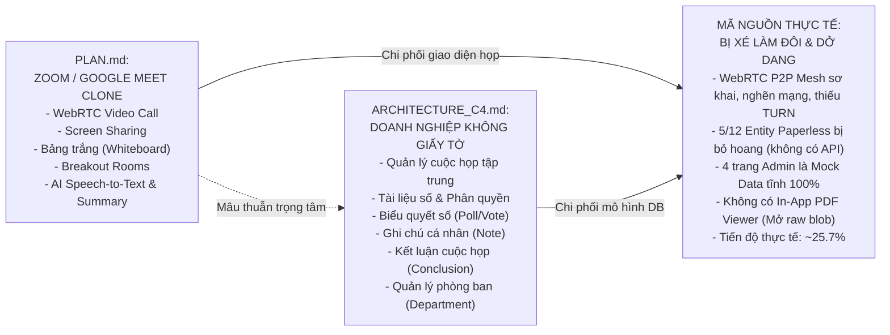

# ĐỐI CHIẾU THỰC TẾ & CÁC QUYẾT ĐỊNH KIẾN TRÚC (GAP ANALYSIS & ARCHITECTURE DECISIONS)
**Dự án:** Paperless Meeting System (`Project_3`)  
**Ngày thực hiện:** 21/11/2026  
**Vai trò:** Lead Systems Architect & Orchestrator  
**Tài liệu tham chiếu:** `PLAN.md`, `BE/ARCHITECTURE_C4.md`, `README.md`, và Mã nguồn thực tế tại `BE/` và `FE/`

---

## 1. PHÂN TÍCH MÂU THUẪN ĐỊNH HƯỚNG SẢN PHẨM (PRODUCT VISION CONFLICT)

Một trong những phát hiện nghiêm trọng nhất của đợt kiểm toán này là **sự xung đột định vị sản phẩm sâu sắc** giữa các tài liệu thiết kế và mã nguồn thực tế:

### 1.1 Chi Tiết Sự Bất Nhất Giữa 3 Nguồn

1. **`PLAN.md` (Định hướng Công cụ Họp Trực tuyến Video):**
   - Định nghĩa dự án như một phiên bản mã nguồn mở của Zoom hoặc MS Teams.
   - Tập trung toàn bộ lộ trình 4 giai đoạn vào các tính năng media nặng: WebRTC, Screen Sharing, Giơ tay, Chat, Breakout Rooms, Bảng trắng tương tác, và xử lý AI âm thanh trực tiếp (Live STT, Auto Summary).
   - Hoàn toàn xem nhẹ các nghiệp vụ quản trị văn phòng: phòng ban, phân cấp tài liệu, biểu quyết đại biểu, ký số và biên bản pháp lý.

2. **`BE/ARCHITECTURE_C4.md` (Định hướng Hệ thống Quản trị Phòng họp Không Giấy Tờ):**
   - Định nghĩa dự án là giải pháp số hóa toàn diện phòng họp cho cơ quan nhà nước / doanh nghiệp nhằm loại bỏ hoàn toàn tài liệu in ấn trên giấy.
   - Trọng tâm nghiệp vụ: Lập lịch họp theo phòng ban, số hóa tài liệu mật theo phân quyền, biểu quyết số kín/hở, ghi chép cá nhân đồng bộ, kết luận cuộc họp làm căn cứ pháp lý, và lưu trữ bản ghi âm cuộc họp.

3. **Mã Nguồn Thực Tế (`BE/` và `FE/`):**
   - **Tầng Cơ sở Dữ liệu:** Được tạo theo C4 với 12 Entity Models. Nhưng lập trình viên mới chỉ viết Controller/Service cho 7 entity. Các bảng cốt lõi của Paperless là `Note`, `Conclusion`, `MeetingAudio`, `MeetingLog`, và `Department` **hoàn toàn không có bất kỳ dòng code API hay logic nào**!
   - **Tầng Giao diện Người dùng (FE):** Bị "chắp vá" kỳ lạ. Phía người dùng có danh sách cuộc họp hành chính theo lịch sáng/chiều ([HomePage.jsx](file:///c:/Users/coc14/OneDrive/Documents/GitHub/Project_3/FE/src/pages/HomePage.jsx#L23-L36)). Nhưng khi bấm "Vào họp", hệ thống lại đưa thẳng vào giao diện WebRTC Mesh Video ([MeetingDetailPage.jsx](file:///c:/Users/coc14/OneDrive/Documents/GitHub/Project_3/FE/src/pages/MeetingDetailPage.jsx)) - nơi **hoàn toàn biến mất tài liệu, không có biểu quyết, không có ghi chú, thậm chí không có cả Text Chat**! Phía Admin, các trang Rooms, Documents, Reports thực chất là **Mock Data 100%** tĩnh.

### 1.2 Hệ Quả Nghiêm Trọng Của Việc "Bắt Cá Hai Tay"
- **Không có tính năng nào đạt chuẩn Production:** Nỗ lực phát triển bị phân tán làm đôi khiến cả hai mảng đều dang dở. Mảng Video Call thì dùng kiến trúc Mesh P2P lỗi thời (nghẽn mạng khi quá 4 người) và thiếu TURN Server khiến cuộc gọi chết trên 4G. Mảng Paperless thì bỏ rơi 50% thực thể nghiệp vụ cốt lõi, Admin UI chỉ là bản vẽ tĩnh.
- **Trải nghiệm người dùng đứt gãy:** Tab Voting và Notes trong trang chi tiết cuộc họp ghi thẳng: `/* Voting and Notes tabs remain demo for now */` ([MeetingDetailsPage.jsx:266](file:///c:/Users/coc14/OneDrive/Documents/GitHub/Project_3/FE/src/pages/admin/MeetingDetailsPage.jsx#L266)). Tài liệu thì không có trình xem (Viewer) mà chỉ mở tab mới dạng thô.

---

## 2. MA TRẬN TÍNH NĂNG THỰC TẾ (FEATURE REALITY MATRIX)

Bảng ma trận đối chiếu toàn bộ 27 tính năng được đề cập trong tài liệu với mã nguồn thực tế theo 5 cấp độ chuẩn xác:
1. **Chưa làm (0%):** Hoàn toàn chưa có dòng code nào trong repository.
2. **Chỉ có DB/Skeleton (10-25%):** Mới có Model C# hoặc UI mock tĩnh, chưa có API hoặc business logic.
3. **Có BE chưa có FE (40-60%):** API và DB hoạt động nhưng FE chưa kết nối hoặc chưa có giao diện.
4. **Hoạt động một phần/Có bug (60-80%):** Đã kết nối BE-FE nhưng dính lỗi logic, thiếu validation hoặc thiếu bảo mật.
5. **Hoàn thiện (90-100%):** Đầy đủ luồng nghiệp vụ, bảo mật, xử lý lỗi, sẵn sàng sử dụng.

| STT | Tên tính năng | Nguồn tài liệu | Trạng thái thực tế | % Hoàn thành | Dẫn chứng mã nguồn (File:Line) | Nhận xét kỹ thuật & Lỗ hổng tồn đọng |
| :---: | :--- | :--- | :--- | :---: | :--- | :--- |
| **1** | **Xác thực JWT & Refresh Token** | PLAN/C4 | **Hoàn thiện** | **95%** | BE: [AuthService.cs:79-150](file:///c:/Users/coc14/OneDrive/Documents/GitHub/Project_3/BE/Paperless_Meeting/Services/Auth/AuthService.cs#L79-L150) FE: [LoginPage.jsx:20-50](file:///c:/Users/coc14/OneDrive/Documents/GitHub/Project_3/FE/src/pages/LoginPage.jsx#L20-L50) | Đầy đủ Access Token, Refresh Token Rotation, hash BCrypt. Điểm trừ: Hardcode JWT Key trong `appsettings.json`, FE thiếu auto-refresh token. |
| **2** | **Quản lý Hồ sơ cá nhân (Profile)** | PLAN GĐ1 | **Hoạt động một phần/Có bug** | **65%** | BE: [AuthController.cs:120-147](file:///c:/Users/coc14/OneDrive/Documents/GitHub/Project_3/BE/Paperless_Meeting/Controllers/Auth/AuthController.cs#L120-L147) | Có API cập nhật profile (`PUT /api/auth/profile/{id}`). FE chỉ hiển thị tên trên Header, chưa có Form cho user tự đổi thông tin cá nhân/mật khẩu. |
| **3** | **Quản lý User & Phân quyền Admin** | PLAN/C4 | **Hoạt động một phần/Có bug** | **70%** | BE: [AuthController.cs:84-194](file:///c:/Users/coc14/OneDrive/Documents/GitHub/Project_3/BE/Paperless_Meeting/Controllers/Auth/AuthController.cs#L84-L194) FE: [UsersPage.jsx:13-208](file:///c:/Users/coc14/OneDrive/Documents/GitHub/Project_3/FE/src/pages/admin/UsersPage.jsx#L13-L208) | Admin thêm user qua API hoạt động. Nhược điểm: Hardcode danh sách phòng ban ở FE ([UsersPage.jsx:5-11](file:///c:/Users/coc14/OneDrive/Documents/GitHub/Project_3/FE/src/pages/admin/UsersPage.jsx#L5-L11)), nút Lock/Unlock chưa gắn API backend. |
| **4** | **Quản lý Cuộc họp (CRUD & Lịch họp)** | PLAN/C4 | **Hoạt động một phần/Có bug** | **75%** | BE: [MeetingsController.cs:26-140](file:///c:/Users/coc14/OneDrive/Documents/GitHub/Project_3/BE/Paperless_Meeting/Controllers/Meeting/MeetingsController.cs#L26-L140) FE: [MeetingTable.jsx:116-148](file:///c:/Users/coc14/OneDrive/Documents/GitHub/Project_3/FE/src/components/MeetingTable.jsx#L116-L148) | Tạo, sửa, xóa, lấy danh sách meeting hoạt động. Lỗ hổng: `GetAllMeetings` trả về toàn bộ cuộc họp công ty; bug đè `description = location` trong context. |
| **5** | **Quản lý Người tham gia (Participants)** | C4 | **Có BE chưa có FE** | **50%** | BE: [ParticipantController.cs:27-172](file:///c:/Users/coc14/OneDrive/Documents/GitHub/Project_3/BE/Paperless_Meeting/Controllers/Meeting/ParticipantController.cs#L27-L172) FE: [MeetingDetailsPage.jsx:44-62](file:///c:/Users/coc14/OneDrive/Documents/GitHub/Project_3/FE/src/pages/admin/MeetingDetailsPage.jsx#L44-L62) | BE có đủ API thêm đơn lẻ, thêm bulk, xóa participant. FE chỉ có bảng hiển thị Read-only trong chi tiết meeting, chưa có UI cho Host thêm/bớt đại biểu. |
| **6** | **Phòng chờ (Waiting Room)** | PLAN GĐ1 | **Chưa làm** | **0%** | Không có mã nguồn | Chưa có bất kỳ logic hoặc SignalR event nào trong toàn bộ repo. |
| **7** | **WebRTC Audio/Video (P2P Grid)** | PLAN GĐ1 | **Hoạt động một phần/Có bug** | **65%** | BE: [MeetingHub.cs:153-172](file:///c:/Users/coc14/OneDrive/Documents/GitHub/Project_3/BE/Paperless_Meeting/Hubs/MeetingHub.cs#L153-L172) FE: [useMeeting.js:494-553](file:///c:/Users/coc14/OneDrive/Documents/GitHub/Project_3/FE/src/hook/useMeeting.js#L494-L553) | P2P hoạt động được với 2-3 người. **Điểm chết**: Thiếu TURN Server (chết trên 4G), rò rỉ PeerConnection khi unmount, hardcode port 5075. |
| **8** | **Chia sẻ màn hình (Screen Sharing)** | PLAN GĐ2 | **Hoạt động một phần/Có bug** | **60%** | BE: [MeetingHub.cs:223-305](file:///c:/Users/coc14/OneDrive/Documents/GitHub/Project_3/BE/Paperless_Meeting/Hubs/MeetingHub.cs#L223-L305) FE: [useMeeting.js:838-879](file:///c:/Users/coc14/OneDrive/Documents/GitHub/Project_3/FE/src/hook/useMeeting.js#L838-L879) | FE thay track màn hình cục bộ. Bug: FE không invoke SignalR Hub để báo trạng thái; BE bị duplicate broadcast sự kiện `ScreenShareStarted`. |
| **9** | **Trò chuyện văn bản (Text Chat)** | PLAN GĐ1 | **Có BE chưa có FE** | **40%** | BE: [MeetingHub.cs:175-203](file:///c:/Users/coc14/OneDrive/Documents/GitHub/Project_3/BE/Paperless_Meeting/Hubs/MeetingHub.cs#L175-L203) FE: [useMeeting.js:896-897](file:///c:/Users/coc14/OneDrive/Documents/GitHub/Project_3/FE/src/hook/useMeeting.js#L896-L897) | BE có method `SendMessage`. Hook FE có `ReceiveMessage`, nhưng trong [MeetingDetailPage.jsx](file:///c:/Users/coc14/OneDrive/Documents/GitHub/Project_3/FE/src/pages/MeetingDetailPage.jsx) **hoàn toàn không có giao diện Chat Box**! |
| **10** | **Quản lý & Tải tài liệu (File Storage)** | PLAN/C4 | **Hoạt động một phần/Có bug** | **70%** | BE: [DocumentsController.cs:31-227](file:///c:/Users/coc14/OneDrive/Documents/GitHub/Project_3/BE/Paperless_Meeting/Controllers/Meeting/DocumentsController.cs#L31-L227) FE: [MeetingDocumentsPage.jsx:28-84](file:///c:/Users/coc14/OneDrive/Documents/GitHub/Project_3/FE/src/pages/MeetingDocumentsPage.jsx#L28-L84) | Upload/Download tệp tin hoạt động. Lỗ hổng: IDOR tải trộm tài liệu, không mount volume Docker (mất trắng file), lộ static file ra public. |
| **11** | **Xem tài liệu trực tiếp không cần tải** | PLAN GĐ2 | **Chưa làm** | **15%** | FE: [MeetingDocumentsPage.jsx:45-61](file:///c:/Users/coc14/OneDrive/Documents/GitHub/Project_3/FE/src/pages/MeetingDocumentsPage.jsx#L45-L61) | Nút "Xem" thực chất chỉ gọi `window.open(blobUrl)`. Không có PDF Viewer nhúng, file office tự động tải về thay vì hiển thị. |
| **12** | **Đồng bộ Slide thời gian thực** | PLAN GĐ2 | **Chưa làm** | **0%** | Không có mã nguồn | Chưa có bất kỳ dòng code nào về đồng bộ số trang hay laser pointer qua SignalR. |
| **13** | **Biểu quyết & Bỏ phiếu (Poll & Voting)** | PLAN/C4 | **Có BE chưa có FE** | **50%** | BE: [PollsController.cs:45-150](file:///c:/Users/coc14/OneDrive/Documents/GitHub/Project_3/BE/Paperless_Meeting/Controllers/Meeting/PollsController.cs#L45-L150) FE: [MeetingDetailsPage.jsx:266](file:///c:/Users/coc14/OneDrive/Documents/GitHub/Project_3/FE/src/pages/admin/MeetingDetailsPage.jsx#L266) | BE hoàn chỉnh: tạo poll, bỏ phiếu, broadcast SignalR. FE bỏ trống tab Voting (`/* Voting and Notes tabs remain demo for now */`). BE vi phạm bỏ phiếu kín. |
| **14** | **Ghi chú cá nhân & Biên bản họp** | PLAN/C4 | **Chỉ có DB/Skeleton** | **15%** | BE: [Note.cs](file:///c:/Users/coc14/OneDrive/Documents/GitHub/Project_3/BE/Paperless_Meeting/Models/Note.cs), [PaperlessMeetingDbContext.cs:19](file:///c:/Users/coc14/OneDrive/Documents/GitHub/Project_3/BE/Paperless_Meeting/Data/PaperlessMeetingDbContext.cs#L19) | Chỉ có Model `Note` và DbSet trong C#. Không có Controller, không có Service, không có UI. Bị bỏ hoang hoàn toàn. |
| **15** | **Kết luận cuộc họp (Conclusion)** | C4 | **Chỉ có DB/Skeleton** | **15%** | BE: [Conclusion.cs](file:///c:/Users/coc14/OneDrive/Documents/GitHub/Project_3/BE/Paperless_Meeting/Models/Conclusion.cs), [PaperlessMeetingDbContext.cs:12](file:///c:/Users/coc14/OneDrive/Documents/GitHub/Project_3/BE/Paperless_Meeting/Data/PaperlessMeetingDbContext.cs#L12) | Đã có Model `Conclusion` trong DB. Hoàn toàn không có Controller, Service hay giao diện kết luận biên bản cuộc họp. |
| **16** | **Ghi âm cuộc họp (Meeting Audio)** | PLAN/C4 | **Chỉ có DB/Skeleton** | **15%** | BE: [MeetingAudio.cs](file:///c:/Users/coc14/OneDrive/Documents/GitHub/Project_3/BE/Paperless_Meeting/Models/MeetingAudio.cs), [PaperlessMeetingDbContext.cs:15](file:///c:/Users/coc14/OneDrive/Documents/GitHub/Project_3/BE/Paperless_Meeting/Data/PaperlessMeetingDbContext.cs#L15) | Có Model `MeetingAudio` trong C#. Chưa có MediaRecorder ở FE, không có upload audio hay player phát lại. |
| **17** | **Quyền điều khiển Host (Mute all, Kick, Lock)** | PLAN GĐ2 | **Chưa làm** | **5%** | FE: [VideoTile.tsx:266-272](file:///c:/Users/coc14/OneDrive/Documents/GitHub/Project_3/FE/src/components/VideoTile.tsx#L266-L272) (Nút mock onRemove) | Có nút X trên VideoTile nhưng không có handler. BE không có method `KickUser`, `MuteAll`, `LockRoom`. |
| **18** | **Giơ tay phát biểu (Raise Hand)** | PLAN GĐ2 | **Chưa làm** | **0%** | Không có mã nguồn | Chưa phát triển. |
| **19** | **Quản lý Phòng họp vật lý (Rooms)** | C4 | **Chỉ có DB/Skeleton** | **10%** | FE: [RoomsPage.jsx:5-9](file:///c:/Users/coc14/OneDrive/Documents/GitHub/Project_3/FE/src/pages/admin/RoomsPage.jsx#L5-L9) | Màn hình Rooms của Admin là HTML với mảng tĩnh 3 phòng họp ảo. Không có bảng Room trong DB, không có API backend. |
| **20** | **Báo cáo & Thống kê (Analytics)** | PLAN/C4 | **Chỉ có DB/Skeleton** | **15%** | FE: [ReportsPage.jsx:9-13](file:///c:/Users/coc14/OneDrive/Documents/GitHub/Project_3/FE/src/pages/admin/ReportsPage.jsx#L9-L13) | Toàn bộ biểu đồ tháng, tỷ lệ tham gia 82%, hiệu suất phòng họp đều là số liệu Mock hardcode trong React component. |
| **21** | **Quản lý Phòng ban (Department)** | C4 | **Chỉ có DB/Skeleton** | **20%** | BE: [Department.cs](file:///c:/Users/coc14/OneDrive/Documents/GitHub/Project_3/BE/Paperless_Meeting/Models/Department.cs), Seed data [PaperlessMeetingDbContext.cs:105-111](file:///c:/Users/coc14/OneDrive/Documents/GitHub/Project_3/BE/Paperless_Meeting/Data/PaperlessMeetingDbContext.cs#L105-L111) | Có bảng Department trong DB và seed 5 phòng ban. Không có CRUD API quản lý phòng ban. |
| **22** | **Nhật ký cuộc họp (Meeting Logs)** | C4 | **Chỉ có DB/Skeleton** | **15%** | BE: [MeetingLog.cs](file:///c:/Users/coc14/OneDrive/Documents/GitHub/Project_3/BE/Paperless_Meeting/Models/MeetingLog.cs), [PaperlessMeetingDbContext.cs:16](file:///c:/Users/coc14/OneDrive/Documents/GitHub/Project_3/BE/Paperless_Meeting/Data/PaperlessMeetingDbContext.cs#L16) | Có Model `MeetingLog` trong DB. Không có service ghi log khi user tương tác trong phòng họp. |
| **23** | **Bảng trắng tương tác (Whiteboard)** | PLAN GĐ3 | **Chưa làm** | **0%** | Không có mã nguồn | Chưa phát triển. |
| **24** | **AI Live Speech-to-Text** | PLAN GĐ4 | **Chưa làm** | **0%** | Không có mã nguồn | Chưa tích hợp engine STT nào. |
| **25** | **AI Meeting Summary (Tóm tắt họp)** | PLAN GĐ4 | **Chưa làm** | **0%** | Không có mã nguồn | Chưa tích hợp LLM nào. |
| **26** | **Tích hợp Calendar (Google/Outlook)** | PLAN GĐ4 | **Chưa làm** | **0%** | Không có mã nguồn | Chưa có đồng bộ lịch bên ngoài. |
| **27** | **Đăng nhập Single Sign-On (SSO)** | PLAN GĐ4 | **Chưa làm** | **0%** | Không có mã nguồn | Chưa hỗ trợ SSO. |

### ĐỊNH LƯỢNG TIẾN ĐỘ THỰC TẾ CỦA DỰ ÁN
$$\text{Tiến độ thực tế tổng thể} = \frac{\sum (\text{\% hoàn thành của 27 tính năng})}{27} = \frac{695}{27} \approx \mathbf{25.7\%}$$

Con số này phản ánh sự thật: **Gần 75% khối lượng công việc được mô tả trong các tài liệu thiết kế hoặc chưa được viết một dòng code nào, hoặc mới chỉ dừng lại ở mức mô hình dữ liệu rỗng và giao diện tĩnh**.

---

## 3. ĐÁNH GIÁ TÍNH KHẢ THI KỸ THUẬT & CÁC NÚT THẮT HẠ TẦNG

Đối với các tính năng nặng được phác thảo trong `PLAN.md`, kiểm toán kỹ thuật chỉ ra các rào cản kiến trúc cốt tử sau:

### 3.1 WebRTC Real-Time Media: P2P Mesh vs SFU & Nút thắt STUN/TURN
- **Giới hạn vật lý của P2P Mesh:** Mô hình hiện tại trong `useMeeting.js` yêu cầu mỗi client thiết lập kết nối ngang hàng trực tiếp với tất cả những người khác ($N-1$ peer connections).
  - Với phòng họp 6 người: Mỗi máy phải đồng thời encode và tải lên 5 luồng video, đồng thời decode 5 luồng tải về. Yêu cầu băng thông tải lên tối thiểu: $5 \times 1.5\text{ Mbps} = 7.5\text{ Mbps}$ liên tục.
  - Hậu quả: Laptop của người tham gia sẽ bị quá tải CPU (quạt hú to, giật lag), băng thông mạng gia đình/văn phòng bị nghẽn, dẫn đến vỡ hình và rớt kết nối liên tục khi phòng họp vượt quá 4-5 người.
- **Thảm họa thiếu máy chủ TURN:**
  - Hiện tại hệ thống chỉ khai báo STUN Server miễn phí của Google ([useMeeting.js:470](file:///c:/Users/coc14/OneDrive/Documents/GitHub/Project_3/FE/src/hook/useMeeting.js#L470)). STUN chỉ có thể giải quyết NAT dạng Full Cone hoặc Restricted Cone.
  - Trên mạng di động 4G (Viettel, VinaPhone, Mobifone) hoặc mạng cơ quan nhà nước có tường lửa bảo mật cao, NAT hầu hết là **Symmetric NAT**. Khi đó, hai client không thể đục lỗ (hole punching) trực tiếp tới nhau. Nếu không có máy chủ **TURN (Coturn)** làm trạm chuyển tiếp dữ liệu (Relay), WebRTC handshake sẽ **thất bại 100% (ICE Connection State: Failed)**.

### 3.2 Đồng Bộ Slide/Tài Liệu Thời Gian Thực (Slide Sync vs Screen Share)
- Trong `PLAN.md`, việc trình chiếu tài liệu đang dựa vào Screen Sharing (chia sẻ màn hình).
- **Rủi ro Screen Sharing:** Ngốn băng thông khủng khiếp (1.5 - 3 Mbps), chất lượng chữ trong văn bản PDF bị nén mờ (khó đọc số liệu nhỏ trên báo cáo tài chính), không thể tra cứu độc lập trang khác trong lúc người thuyết trình đang nói.
- **Giải pháp khả thi (PDF Vector Sync qua SignalR):**
  - Tích hợp thư viện **PDF.js** hiển thị trực tiếp file PDF vector tại client.
  - Khi Host lật trang, trỏ laser pointer hoặc highlight, SignalR chỉ cần phát một bản tin JSON siêu nhẹ (`{ page: 5, zoom: 1.2, pointer: { x: 120, y: 340 } }` - dung lượng < 1KB).
  - Băng thông giảm 99.9%, chữ hiển thị sắc nét tuyệt đối, đại biểu có thể tạm ngắt đồng bộ để đọc trước các trang tài liệu đính kèm khác.

### 3.3 Lưu Trữ Tệp Tin: Local Volume vs MinIO / S3 Object Storage
- Hiện tại, file tài liệu được lưu trực tiếp vào đĩa cứng Backend ([DocumentService.cs:41](file:///c:/Users/coc14/OneDrive/Documents/GitHub/Project_3/BE/Paperless_Meeting/Services/Document/DocumentService.cs#L41)), Controller đọc toàn bộ file vào `MemoryStream` ([DocumentsController.cs:211](file:///c:/Users/coc14/OneDrive/Documents/GitHub/Project_3/BE/Paperless_Meeting/Controllers/Meeting/DocumentsController.cs#L211)).
- **Nút thắt:**
  - Nếu 50 người trong phòng họp cùng bấm tải tài liệu 100MB, RAM của máy chủ Backend sẽ bị chiếm dụng $50 \times 100\text{MB} = 5\text{GB}$ RAM tức thì, dễ dẫn tới lỗi `OutOfMemoryException`.
  - Không thể chạy đa container Backend (scale out) vì file lưu trên local disk của node này thì node khác không thấy.
- **Giải pháp chuẩn:** Sử dụng **MinIO** (tự host on-premise) hoặc **S3-compatible storage**. Backend chỉ quản lý metadata và sinh **Presigned Download/Upload URL**. Trình duyệt của người dùng sẽ upload/download trực tiếp với MinIO, giải phóng 100% tải I/O và RAM cho Backend Kestrel.

### 3.4 AI Speech-to-Text & Tóm Tắt Cuộc Họp: Xử Lý Bất Đồng Bộ
- Việc xử lý âm thanh cuộc họp dài 1 đến 2 tiếng (kích thước file âm thanh WAV/MP3 từ 50MB đến 200MB) hoàn toàn **không thể chạy đồng bộ qua REST API** (sẽ bị HTTP timeout 504 Gateway Timeout).
- **Kiến trúc khả thi:**
  - Cần hệ thống hàng đợi tác vụ nền (Background Queue: Hangfire hoặc RabbitMQ).
  - Sau khi cuộc họp kết thúc, worker nền sẽ lấy file audio, thực hiện Audio Chunking (cắt thành các đoạn 30 giây), gọi mô hình STT (OpenAI Whisper on-premise hoặc Google Cloud STT API) để sinh transcript có đánh dấu mốc thời gian (Timestamps) và danh tính người nói (Speaker Diarization).
  - Transcript hoàn chỉnh được nạp vào Gemini 1.5 Flash / GPT-4o để trích xuất 3 nội dung cốt lõi: Tóm tắt điều hành, Danh sách quyết định đã chốt, và Bảng phân công nhiệm vụ (Action Items: Ai làm gì, hạn chót khi nào).

---

## 4. BỐN QUYẾT ĐỊNH KIẾN TRÚC THEN CHỐT (ARCHITECTURE DECISION RECORDS - ADRs)

Dưới đây là 4 ADRs có tính chất định hình toàn bộ tương lai của dự án cần Ban Quản trị / Tech Lead phê duyệt:

---

### ADR-01: Định Vị Lõi Sản Phẩm (Core Product Positioning)
- **Trạng thái:** Accepted (2026-11-21)
- **Bối cảnh:**
  Dự án đang bị giằng xé giữa 2 định hướng: làm một bản sao Zoom/Meet (chú trọng Video call WebRTC) hay làm một Hệ thống Phòng họp Không Giấy Tờ cho doanh nghiệp/cơ quan (chú trọng tài liệu số, biểu quyết, ghi chú, kết luận). Việc làm cả hai cùng lúc với nguồn lực hiện tại đã khiến sản phẩm chỉ đạt 25.7% tiến độ và chứa đầy lỗi P0.
- **Các phương án xem xét:**
  - *Phương án A:* Dồn toàn lực cạnh tranh trực tiếp với Zoom/Teams (tập trung WebRTC video, chat, whiteboard, screen share).
  - *Phương án B (Khuyến nghị):* **Tập trung hoàn thiện Nền tảng Quản trị Cuộc họp Không Giấy Tờ (Paperless Governance)**. Hoàn thiện nghiệp vụ tài liệu số phân quyền, biểu quyết số bảo mật, ghi chú và biên bản kết luận cuộc họp. WebRTC Video Call chỉ đóng vai trò kênh phụ trợ (kết nối remote cho đại biểu vắng mặt).
- **Lý do chọn Phương án B:**
  - Zoom/Teams/Google Meet đã hoàn hảo về mảng truyền thông video và có hàng nghìn kỹ sư tối ưu codec/hạ tầng toàn cầu. Dự án không thể cạnh tranh về chất lượng truyền hình ảnh.
  - Giá trị thương mại và sự khác biệt độc bản của dự án nằm ở **quy trình nghiệp vụ không giấy tờ** (Paperless): trước họp (gửi tài liệu mật, biểu quyết xin ý kiến trước), trong họp (xem tài liệu vector, biểu quyết kín/hở, ghi chép cá nhân), và sau họp (tự động ban hành biên bản, kết luận cuộc họp).
- **Hệ quả & Hành động:**
  - Ưu tiên triển khai đầy đủ các thực thể đang bị bỏ hoang: `Note`, `Conclusion`, `Department`, `MeetingAudio`.
  - Hoàn thiện các trang Admin đang là Mockup tĩnh thành dữ liệu động kết nối DB thật.

---

### ADR-02: Kiến Trúc Real-Time Media (WebRTC Architecture)
- **Trạng thái:** Accepted (2026-11-21)
- **Bối cảnh:**
  WebRTC hiện tại đang chạy mô hình Full-Mesh P2P (mỗi người nối trực tiếp tới $N-1$ người khác) và chỉ cấu hình Google STUN, thiếu máy chủ TURN. Mạng 4G và tường lửa cơ quan khiến cuộc gọi rớt 100%, và phòng trên 4 người làm đơ máy trạm.
- **Các phương án xem xét:**
  - *Phương án A:* Giữ nguyên P2P Mesh không sửa đổi.
  - *Phương án B (Khuyến nghị 2 giai đoạn):*
    - **Giai đoạn 1 (Ngay lập tức):** Giữ P2P Mesh cho phòng họp nhỏ (<= 4 người), nhưng **bắt buộc bổ sung máy chủ Coturn (STUN/TURN)** trong Docker Compose để mở thông luồng qua mạng 4G/tường lửa. Sửa dứt điểm rò rỉ bộ nhớ `pc.close()`.
    - **Giai đoạn 2 (Khi mở rộng):** Tích hợp máy chủ **LiveKit SFU** (Selective Forwarding Unit) chạy container riêng biệt. LiveKit cung cấp SDK React sẵn có, tự động thích ứng băng thông (Simulcast/Dynacast), hỗ trợ phòng họp 50-100 người ổn định.
  - *Phương án C:* Tích hợp dịch vụ bên thứ 3 (Twilio, Agora). (Nhược điểm: Tốn chi phí định kỳ cao, dữ liệu video đi qua máy chủ bên ngoài, vi phạm quy định bảo mật cơ quan nhà nước).
- **Hệ quả & Hành động:**
  - Bổ sung service `coturn` vào `docker-compose.yml` với cổng 3478 UDP/TCP.
  - Cập nhật ICE Servers configuration trong `useMeeting.js`.

---

### ADR-03: Chiến Lược Lưu Trữ & Trình Chiếu Tài Liệu (Storage & In-App Preview)
- **Trạng thái:** Accepted (2026-11-21)
- **Bối cảnh:**
  Tài liệu hiện lưu trực tiếp trên đĩa cứng máy chủ Backend, tải qua MemoryStream, không mount Docker volume (restart container là mất sạch file), và giao diện FE chỉ có nút mở file ra tab mới bằng `window.open(blob)`.
- **Các phương án xem xét:**
  - *Phương án A (Khuyến nghị):*
    - **Lưu trữ:** Trong Phase 0, cấu hình Docker Persistent Volume `backend_uploads` để chống mất dữ liệu. Trong Phase tiếp theo, tích hợp **MinIO Object Storage** (chuẩn S3) chạy local container, sử dụng cơ chế Presigned URL.
    - **Trình chiếu (In-App Preview):** Tích hợp thư viện **`react-pdf` / PDF.js** trực tiếp vào giao diện phòng họp. Cho phép đại biểu đọc tài liệu trực tiếp trong phòng họp mà không cần rời màn hình hay tải file về máy.
    - **Đồng bộ Slide:** Sử dụng SignalR Hub truyền thông điệp điều khiển số trang (`CurrentPage`, `ZoomLevel`) từ người chủ trì tới tất cả người tham gia.
  - *Phương án B:* Tiếp tục lưu đĩa cứng và dùng Screen Sharing để chiếu tài liệu. (Bị bác bỏ do tốn băng thông và mờ chữ).
- **Hệ quả & Hành động:**
  - Bổ sung thư viện `react-pdf` vào `FE/package.json`.
  - Viết component `<DocumentViewerModal />` và `<EmbeddedPdfViewer />`.
  - Bổ sung volume mount trong `docker-compose.yml`.

---

### ADR-04: Chuẩn Hóa Kiến Trúc Backend & Chiến Lược Kiểm Thử (Backend Standardization & Test Strategy)
- **Trạng thái:** Accepted (2026-11-21)
- **Bối cảnh:**
  Backend hiện tại có thư mục `Repositories/` nhưng thực chất chỉ chứa Service Interfaces. Các Service gọi trực tiếp `PaperlessMeetingDbContext`. `Program.cs` dùng `EnsureCreated()` làm gãy EF Core Migrations. Toàn bộ giải pháp có **0% kiểm thử tự động**.
- **Các phương án xem xét:**
  - *Phương án A (Quá mức cần thiết - Over-engineering):* Đập đi xây lại toàn bộ theo Clean Architecture nghiêm ngặt (tách 5 projects: Domain, Application, Infrastructure, Persistence, API), viết Repository Pattern và UnitOfWork cho 12 bảng. (Rủi ro: Mất quá nhiều thời gian, làm chậm tiến độ dự án).
  - *Phương án B (Thực dụng & Tối ưu - Pragmatic Refactoring - Khuyến nghị):*
    - **Tái cấu trúc thư mục:** Đổi tên thư mục `Repositories/` thành `Services/Interfaces/` hoặc `Contracts/` cho đúng bản chất.
    - **Giữ kiến trúc Service Layer + EF Core:** Cho phép Service sử dụng `DbContext` vì bản thân `DbContext` và `DbSet` trong EF Core đã là UnitOfWork và Repository pattern chuẩn.
    - **Khôi phục EF Core Migrations:** Chạy `dotnet ef migrations add InitialCreate` để tạo bảng theo dõi schema `__EFMigrationsHistory`, xóa bỏ lệnh `EnsureCreated()` trong `Program.cs`, thay bằng `db.Database.Migrate()`.
    - **Chiến lược Kiểm thử:** Tạo project `Paperless_Meeting.Tests` sử dụng **xUnit**, **Moq**, và **FluentAssertions**. Tập trung kiểm thử:
      1. Unit Test: Logic xác thực JWT, Refresh Token Rotation, kiểm tra quyền Host/Participant.
      2. Integration Test: Các API upload tài liệu, tạo cuộc họp kèm transaction, và bỏ phiếu Poll chống Double-voting.
- **Hệ quả & Hành động:**
  - Solution được tái cấu trúc sạch sẽ, dễ bảo trì mà không tốn công rewrite toàn bộ.
  - Tự động hóa kiểm thử để chặn hồi quy (regression) khi thêm tính năng mới.

---
*Tài liệu này là cơ sở trực tiếp để xây dựng Lộ trình phát triển được điều chỉnh tại [03_REVISED_ROADMAP.md](file:///c:/Users/coc14/OneDrive/Documents/GitHub/Project_3/docs/audit_and_plan/03_REVISED_ROADMAP.md).*
