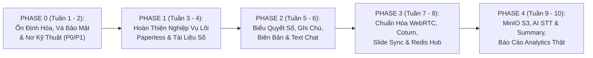
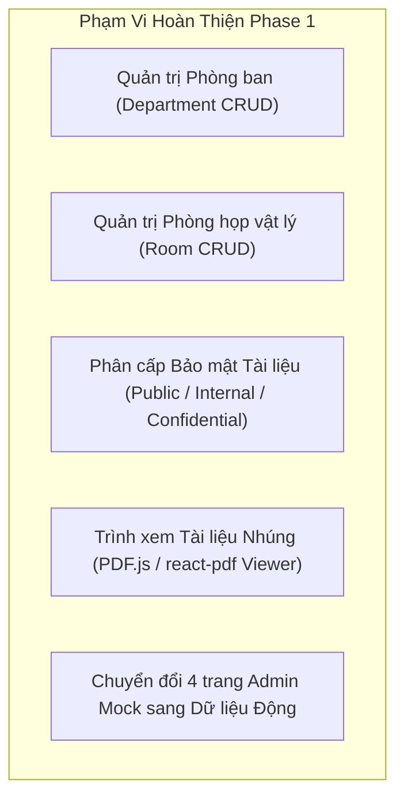

# LỘ TRÌNH PHÁT TRIỂN ĐIỀU CHỈNH (REVISED DEVELOPMENT ROADMAP)
**Dự án:** Paperless Meeting System (`Project_3`)  
**Ngày lập:** 21/11/2026  
**Vai trò:** Lead Systems Architect & Orchestrator  
**Chiến lược phát triển:** Vertical Slices (Hoàn thiện đồng bộ DB + BE + FE + Tests theo từng cụm nghiệp vụ, không dàn hàng ngang dở dang).

---

## 1. TỔNG QUAN CÁC GIAI ĐOẠN PHÁT TRIỂN (PHASE OVERVIEW)

---

## 2. CHI TIẾT TỪNG GIAI ĐOẠN (DETAILED PHASES)

---

### PHASE 0: STABILIZATION, SECURITY HARDENING & TECHNICAL DEBT PAYDOWN
**Thời gian ước tính:** 1 - 2 tuần  
**Mục tiêu tối thượng:** Đưa hệ thống thoát khỏi mức báo động đỏ an ninh mạng, sửa dứt điểm 100% lỗi P0 và P1, sửa lỗi sập build Docker, khôi phục EF Core Migrations, và thiết lập bộ kiểm thử tự động nền tảng (Foundation Tests).

#### Danh Sách Nhiệm Vụ Cụ Thể:
##### Hạ tầng & Bảo mật (Infra & Security):
- [x] **Task 0.1 (P0):** Thu hồi (rotate/revoke) thông tin kết nối CSDL Render Cloud bị lộ. Chuyển cấu hình connection string sang biến môi trường `ConnectionStrings__DefaultConnection`.
- [x] **Task 0.2 (P0):** Xóa bỏ hardcode `Jwt:Key` trong `appsettings.json`, sinh key 256-bit an toàn và nạp qua biến môi trường `Jwt__Key`.
- [x] **Task 0.3 (P0):** Sửa lỗi build frontend trong `docker-compose.yml` (`build: ./FE/FE` -> `build: ./FE`).
- [x] **Task 0.4 (P0):** Thêm named volume `backend_uploads:/app/Uploads` vào service `backend` trong `docker-compose.yml` để chống mất dữ liệu khi restart container.
- [x] **Task 0.5 (P0):** Xóa bỏ khối `app.UseStaticFiles` map `/files` vào `Uploads` trong `BE/Paperless_Meeting/Program.cs:178-189` để ngăn chặn lộ tài liệu mật và Stored XSS.
- [x] **Task 0.6 (P1):** Cập nhật `FE/nginx.conf`:
  - Thêm `location /meetinghub` với các header `Upgrade $http_upgrade` và `Connection "upgrade"`, `proxy_read_timeout 86400s`.
  - Thêm `client_max_body_size 500M;` trong block `server`.
  - Bổ sung HTTP Security Headers: `X-Frame-Options "SAMEORIGIN"`, `X-Content-Type-Options "nosniff"`.
- [x] **Task 0.7 (P1):** Tạo các file `.dockerignore` tại gốc repo, `BE/Paperless_Meeting/` và `FE/` (loại trừ `bin/`, `obj/`, `node_modules/`, `Uploads/`, `.git/`).
- [x] **Task 0.8 (P1):** Hardening Dockerfile Backend: Bổ sung chỉ thị `USER app` để chạy với user non-root.

##### Backend (.NET 8 & EF Core):
- [x] **Task 0.9 (P0):** Thêm `[Authorize(Roles = "SuperAdmin")]` hoặc đóng endpoint `/api/Auth/register/admin` trong `AuthController.cs:32`.
- [x] **Task 0.10 (P0):** Vá lỗ hổng IDOR tại `DocumentsController.DownloadDocument`: Kiểm tra `userId` trong JWT token có thuộc danh sách `MeetingParticipant` của cuộc họp hay không trước khi trả về stream file.
- [x] **Task 0.11 (P1):** Vá lỗ hổng IDOR tại `ParticipantController.AddParticipant`: Bắt buộc kiểm tra `IsHostOfMeetingAsync`.
- [x] **Task 0.12 (P1):** Phân quyền lại `MeetingsController.GetAllMeetings`: Chỉ Admin mới được xem toàn bộ cuộc họp; bổ sung endpoint `GetMyMeetings` cho người dùng thông thường.
- [x] **Task 0.13 (P1):** Chống Double Voting: Thêm Unique Index `(PollId, UserId)` trong `DbContext` cho entity `UserVote` và bọc logic vote trong database transaction.
- [x] **Task 0.14 (P1):** Bọc `CreateMeetingAsync` trong Database Transaction đảm bảo Meeting và Host Participant được tạo nguyên khối.
- [x] **Task 0.15 (P1):** Khôi phục EF Core Migrations: Chạy `dotnet ef migrations add InitialCreate`, xóa bỏ lệnh `db.Database.EnsureCreated()` trong `Program.cs`, thay bằng `db.Database.Migrate()`.
- [x] **Task 0.16 (P1):** Whitelist định dạng file upload (`.pdf`, `.docx`, `.xlsx`, `.pptx`, `.png`, `.jpg`) và kiểm tra Magic Bytes ở header file trong `DocumentService.cs`.
- [ ] **Task 0.17 (P2):** Xóa bỏ đoạn mã duplicate phát sóng sự kiện `ScreenShareStarted` trong `MeetingHub.cs:247-270`. Tắt `EnableDetailedErrors = false` trên môi trường Production.
- [ ] **Task 0.18 (P2):** Dọn dẹp cấu trúc Interfaces: Đổi tên thư mục `Repositories/` thành `Services/Interfaces/`.

##### Frontend (React 18 & Vite):
- [x] **Task 0.19 (P0):** Sửa lỗi crash runtime trong `FE/src/App.jsx:33`: Xóa bỏ route tham chiếu `<MeetingLobby />`, định tuyến nút "Join Meeting" ở Admin về `/meeting/:meetingId/prejoin`.
- [x] **Task 0.20 (P0):** Chuẩn hóa Contract Status Enum giữa BE và FE trong `AppContext.jsx:56`, sửa lỗi toàn bộ cuộc họp bị gán nhầm thành `not_started`.
- [x] **Task 0.21 (P0):** Sửa hardcode SignalR Hub URL trong `useMeeting.js:697` và API URL trong `api.js:2` thành đường dẫn tương đối `/meetinghub` và `/api`.
- [x] **Task 0.22 (P0):** Xây dựng component `ErrorBoundary.jsx` và bọc toàn bộ ứng dụng trong `main.jsx`.
- [x] **Task 0.23 (P1):** Tách timer `currentTime` ra khỏi `AppContext.jsx`, tạo component `<LiveClock />` độc lập để chấm dứt tình trạng re-render toàn bộ ứng dụng mỗi 1 giây.
- [x] **Task 0.24 (P1):** Sửa lỗi rò rỉ WebRTC: Bổ sung vòng lặp đóng `pc.close()` cho toàn bộ peers trong `peersRef.current` tại cleanup function của `useMeeting.js`.
- [x] **Task 0.25 (P1):** Sửa bug đè `description = location` trong `AppContext.jsx:155`.
- [x] **Task 0.26 (P1):** Sửa lỗi so sánh Role Admin không phân biệt hoa thường trong `HomePage.jsx:27`.
- [x] **Task 0.27 (P1):** Sửa bug F5 ở `MeetingDocumentsPage.jsx:19-26`: Gọi API fetch meeting nếu context rỗng thay vì tự động đẩy về trang chủ.
- [x] **Task 0.28 (P1):** Viết lại `api.js` dùng `axios` instance với Interceptor tự động gọi `/api/Auth/refresh-token` khi nhận mã 401 để chống văng khỏi phòng họp.

##### Bộ Kiểm Thử Nền Tảng (Testing Foundation):
- [x] **Task 0.29 (P3):** Tạo project `Paperless_Meeting.Tests` (.NET 8 xUnit + Moq + FluentAssertions).
- [x] **Task 0.30 (P3):** Viết bộ Test Suites nền tảng bao phủ:
  - Auth: Đăng nhập, sinh JWT, Refresh Token Rotation.
  - Security: Kiểm tra quyền truy cập tài liệu (IDOR check).
  - Meeting: Tạo meeting kèm Host participant với transaction rollback khi lỗi.
  - Concurrency: Test 10 threads đồng thời vote cho cùng 1 poll của 1 user (chứng minh chỉ có 1 vote thành công).

#### Tiêu Chí Nghiệm Thu (Acceptance Criteria / Definition of Done - Phase 0):
1. `docker compose up --build` chạy thành công không một lỗi cảnh báo, cả 3 containers (`db`, `backend`, `frontend`) đạt trạng thái Healthy.
2. Không còn bất kỳ secret nào (DB password, JWT key) tồn tại trong git commits hay file cấu hình.
3. Thử tải file tài liệu bằng ID của cuộc họp khác -> Trả về mã lỗi `403 Forbidden`.
4. Đăng nhập tài khoản Admin, bấm "Join Meeting" -> Vào màn hình Prejoin trơn tru, không crash màn hình trắng.
5. Kiểm tra DevTools Profiler: Khi ở màn hình cuộc họp hoặc trang chủ, component không bị re-render mỗi giây nữa.
6. Kết nối SignalR qua WebSocket qua cổng Nginx 3000 hoạt động ổn định (Protocol: 101 Switching Protocols).
7. Bộ Unit/Integration Tests chạy lệnh `dotnet test` đạt **100% Passed** (tối thiểu 15 test cases cốt lõi).

---

### PHASE 1: CORE PAPERLESS GOVERNANCE (VERTICAL SLICE 1 - SỐ HÓA TÀI LIỆU & PHÒNG HỌP)
**Thời gian ước tính:** 2 tuần  
**Mục tiêu:** Hoàn thiện 100% nghiệp vụ quản lý tài liệu số, phòng ban và phòng họp vật lý; tích hợp In-App PDF Viewer để đại biểu xem tài liệu trực tiếp trong cuộc họp không cần tải về.

#### Danh Sách Nhiệm Vụ Cụ Thể:
##### Backend:
- [x] **Task 1.1:** Xây dựng `DepartmentsController` và `DepartmentService` (CRUD phòng ban, gán user vào phòng ban).
- [x] **Task 1.2:** Thêm Entity `Room` (Phòng họp vật lý: tên phòng, sức chứa, trang thiết bị, trạng thái sẵn sàng), tạo migration bổ sung bảng `Rooms` và liên kết với `Meeting.RoomId`.
- [x] **Task 1.3:** Xây dựng `RoomsController` và `RoomService` (CRUD phòng họp, kiểm tra trùng lịch phòng vật lý).
- [x] **Task 1.4:** Nâng cấp `DocumentService`: Quản lý phân quyền tài liệu theo cấp độ bảo mật (`Public`, `Internal`, `Confidential`) dựa trên vai trò của đại biểu trong cuộc họp.
- [x] **Task 1.5:** Xây dựng API stream tài liệu tối ưu (HTTP Range Requests hỗ trợ tua/tải từng phần PDF) thay vì đọc toàn bộ vào MemoryStream.

##### Frontend:
- [x] **Task 1.6:** Tích hợp thư viện `react-pdf` / PDF.js vào FE. Xây dựng component `<InAppDocumentViewer />` cho phép xem trực tiếp văn bản PDF trong modal hoặc split-view bên cạnh màn hình họp.
- [x] **Task 1.7:** Thay thế 100% Mock Data trong [RoomsPage.jsx](file:///c:/Users/coc14/OneDrive/Documents/GitHub/Project_3/FE/src/pages/admin/RoomsPage.jsx) bằng API call thật tới `RoomsController`.
- [x] **Task 1.8:** Thay thế 100% Mock Data trong [DocumentsPage.jsx](file:///c:/Users/coc14/OneDrive/Documents/GitHub/Project_3/FE/src/pages/admin/DocumentsPage.jsx) bằng API call thật, gắn handler tải/xem tài liệu.
- [x] **Task 1.9:** Tái cấu trúc [AdminLayout.jsx](file:///c:/Users/coc14/OneDrive/Documents/GitHub/Project_3/FE/src/pages/admin/AdminLayout.jsx) sử dụng React Router Nested Routes (`<Outlet />`), hỗ trợ bookmark URL và nút Back trình duyệt.
- [x] **Task 1.10:** Hợp nhất 2 form tạo cuộc họp trùng lặp ([AdminCreateMeeting.jsx](file:///c:/Users/coc14/OneDrive/Documents/GitHub/Project_3/FE/src/components/AdminCreateMeeting.jsx) và [CreateMeetingForm.jsx](file:///c:/Users/coc14/OneDrive/Documents/GitHub/Project_3/FE/src/components/admin/CreateMeetingForm.jsx)) thành 1 component chuẩn duy nhất.

#### Tiêu Chí Nghiệm Thu (Acceptance Criteria - Phase 1):
1. Admin có thể tạo mới, chỉnh sửa và quản lý danh mục Phòng ban và Phòng họp vật lý qua giao diện web.
2. Khi lập lịch cuộc họp, hệ thống tự động kiểm tra trùng lặp phòng họp vật lý trong cùng khung giờ.
3. Người dùng mở trang chi tiết cuộc họp bấm "Xem tài liệu" -> Văn bản PDF hiển thị sắc nét trực tiếp trong popup ứng dụng, có thanh phân trang, zoom in/out, không mở tab mới hay tải file về máy.
4. Bấm F5 ở bất kỳ trang admin nào, URL vẫn giữ nguyên và hiển thị đúng tab tương ứng (URL deep-linking thành công).

---

### PHASE 2: INTERACTIVE MEETING & VOTING (VERTICAL SLICE 2 - TƯƠNG TÁC PHÒNG HỌP SỐ)
**Thời gian ước tính:** 2 tuần  
**Mục tiêu:** Kích hoạt các thực thể nghiệp vụ cốt lõi đang bị bỏ hoang: Biểu quyết số (Poll/Vote), Ghi chú cá nhân (Note), Biên bản kết luận (Conclusion), Text Chat và Nhật ký cuộc họp (MeetingLog).

#### Danh Sách Nhiệm Vụ Cụ Thể:
##### Backend:
- [x] **Task 2.1:** Hoàn thiện `PollService`: Bổ sung cơ chế Bỏ phiếu kín (Secret Ballot) - khi poll là kín, API kết quả chỉ trả về tổng số phiếu Yes/No/Abstain, tuyệt đối không trả về `userId` hay danh tính người bỏ phiếu.
- [x] **Task 2.2:** Xây dựng `NotesController` và `NoteService` (CRUD ghi chú cá nhân của từng đại biểu trong cuộc họp, tự động lưu nháp Auto-save, mã hóa nội dung ghi chú).
- [x] **Task 2.3:** Xây dựng `ConclusionsController` và `ConclusionService` (Chủ tọa/Thư ký soạn thảo kết luận cuộc họp, ký duyệt, ban hành biên bản và gửi thông báo tới các đại biểu).
- [x] **Task 2.4:** Xây dựng `MeetingLogService`: Tự động ghi nhật ký hệ thống (Audit Trail) khi đại biểu tham gia/rời phòng, tải tài liệu, bỏ phiếu biểu quyết.
- [x] **Task 2.5:** Bổ sung phương thức lưu trữ tin nhắn Text Chat vào database để phục vụ xem lại lịch sử sau cuộc họp.

##### Frontend:
- [x] **Task 2.6:** Xây dựng giao diện Tab Biểu Quyết Số (Voting Tab) hoàn chỉnh trong phòng họp:
  - Hiển thị danh sách biểu quyết đang diễn ra.
  - Cho phép đại biểu click bỏ phiếu (Đồng ý / Không đồng ý / Ý kiến khác).
  - Lắng nghe SignalR event `PollUpdated` / `VoteSubmitted` để cập nhật biểu đồ kết quả thời gian thực.
- [x] **Task 2.7:** Xây dựng giao diện Tab Ghi Chú Cá Nhân (Personal Notes Tab): Trình soạn thảo văn bản phong phú (Rich Text) tự động lưu sau mỗi 3 giây, cho phép xuất ghi chú ra file PDF/Word cá nhân.
- [x] **Task 2.8:** Xây dựng giao diện Tab Kết Luận & Biên Bản Cuộc Họp (Conclusions Tab) trong trang chi tiết cuộc họp.
- [x] **Task 2.9:** Bổ sung khung Text Chat hoàn chỉnh vào [MeetingDetailPage.jsx](file:///c:/Users/coc14/OneDrive/Documents/GitHub/Project_3/FE/src/pages/MeetingDetailPage.jsx) (danh sách tin nhắn, ô nhập nội dung, hiển thị người gửi, timestamp).

#### Tiêu Chí Nghiệm Thu (Acceptance Criteria - Phase 2):
1. Chủ tọa tạo biểu quyết -> Toàn bộ đại biểu trong phòng họp nhận được thông báo pop-up realtime trên màn hình.
2. Đại biểu thực hiện bỏ phiếu -> Kết quả nhảy số trực tiếp trên biểu đồ của Chủ tọa qua SignalR.
3. Không cử tri nào có thể xem được người khác đã vote phương án nào khi thiết lập biểu quyết kín.
4. Đại biểu ghi chép trong tab Notes, thoát ra vào lại -> Nội dung ghi chú vẫn được bảo toàn nguyên vẹn.
5. Khung chat hoạt động mượt mà, lưu lại lịch sử tin nhắn trong suốt buổi họp.

---

### PHASE 3: MEDIA & REAL-TIME OPTIMIZATION (VERTICAL SLICE 3 - CHUẨN HÓA WEBRTC & ĐỒNG BỘ TRÌNH CHIẾU)
**Thời gian ước tính:** 2 tuần  
**Mục tiêu:** Giải quyết dứt điểm các điểm nghẽn kỹ thuật của WebRTC Media, triển khai máy chủ TURN chống rớt mạng trên 4G, xây dựng cơ chế đồng bộ trang trình chiếu (Slide Sync) qua SignalR, và bổ sung Redis Backplane.

#### Danh Sách Nhiệm Vụ Cụ Thể:
##### Hạ tầng & Network:
- [ ] **Task 3.1:** Thêm container `coturn` vào `docker-compose.yml` (cấu hình STUN/TURN server trên cổng 3478 UDP/TCP, cấu hình username/password xác thực).
- [ ] **Task 3.2:** Bổ sung container `redis:7-alpine` vào `docker-compose.yml` làm Pub/Sub Message Backplane cho SignalR.

##### Backend:
- [ ] **Task 3.3:** Cấu hình Redis Backplane trong `Program.cs` (.NET 8 SignalR Redis integration: `builder.Services.AddSignalR().AddStackExchangeRedis(...)`).
- [ ] **Task 3.4:** Chuyển đổi toàn bộ trạng thái phòng họp từ static in-memory dictionary trong `MeetingHub.cs` sang lưu trữ phân tán trên Redis (Redis Hash / Cache).
- [ ] **Task 3.5:** Bổ sung các SignalR Hub methods cho quyền điều khiển của Chủ tọa (Host Controls): `MuteAllParticipants`, `MuteUser`, `KickParticipant`, `LockMeetingRoom`.
- [ ] **Task 3.6:** Bổ sung SignalR Hub methods cho tính năng Đồng bộ Slide: `BroadcastSlideChange(meetingId, documentId, pageNumber, zoomLevel, pointerCoords)`.
- [ ] **Task 3.7:** Xây dựng API tiếp nhận và ghép file âm thanh ghi âm cuộc họp (`/api/audio/upload-chunk`, `/api/audio/finalize`).

##### Frontend:
- [ ] **Task 3.8:** Cấu hình thông tin máy chủ TURN từ backend vào ICE Servers của `useMeeting.js`.
- [ ] **Task 3.9:** Tích hợp tính năng Đồng bộ Slide Vector: Khi người thuyết trình lật trang trong In-App PDF Viewer, client tự động phát tín hiệu SignalR để đồng bộ số trang trên máy toàn bộ đại biểu tham dự.
- [ ] **Task 3.10:** Tích hợp bộ thu âm phía client (HTML5 `MediaRecorder API`): Thu âm luồng audio cuộc họp và gửi về backend lưu trữ sau khi cuộc họp kết thúc.
- [ ] **Task 3.11:** Bổ sung giao diện điều khiển cho Host (Nút Mute All, Khóa phòng, Mời người ra khỏi phòng họp).

#### Tiêu Chí Nghiệm Thu (Acceptance Criteria - Phase 3):
1. Thử nghiệm gọi WebRTC giữa 2 máy trạm: 1 máy kết nối Wifi văn phòng, 1 máy phát 4G từ điện thoại -> Cuộc gọi thông suốt 100%, không bị lỗi ICE Failed (chứng minh máy chủ TURN hoạt động).
2. Người chủ trì lật trang PDF trên màn hình của mình -> Màn hình của tất cả các đại biểu khác tự động chuyển trang tương ứng với độ trễ < 200ms.
3. Chạy 2 container Backend đằng sau Load Balancer -> Người dùng ở container 1 chat và biểu quyết, người dùng ở container 2 nhận được ngay lập tức qua Redis Backplane.

---

### PHASE 4: ENTERPRISE EXPANSION & AI INTEGRATION (VERTICAL SLICE 4 - MỞ RỘNG DOANH NGHIỆP & AI)
**Thời gian ước tính:** 2 tuần  
**Mục tiêu:** Nâng cấp kho lưu trữ tệp tin lên chuẩn Object Storage (MinIO), triển khai đường ống AI trích xuất biên bản cuộc họp tự động (AI Summary & STT), và hoàn thiện báo cáo phân tích số liệu thật.

#### Danh Sách Nhiệm Vụ Cụ Thể:
- [ ] **Task 4.1:** Bổ sung container `minio` (S3 Compatible Storage) vào `docker-compose.yml`. Tái cấu trúc `DocumentService` sang cơ chế MinIO Presigned URL.
- [ ] **Task 4.2:** Tích hợp Worker xử lý nền (Background Job với Hangfire / RabbitMQ): Tiếp nhận file ghi âm cuộc họp từ Phase 3.
- [ ] **Task 4.3:** Xây dựng đường ống AI Audio Processing:
  - Cắt nhỏ file âm thanh (Audio Chunker).
  - Gọi mô hình Speech-to-Text (OpenAI Whisper on-premise hoặc Gemini API) để sinh văn bản transcript có mốc thời gian.
  - Gọi Gemini 1.5 Flash / GPT-4o trích xuất: Bản tóm tắt điều hành (Executive Summary), Danh sách quyết định đã biểu quyết, và Bảng phân công hành động (Action Items).
- [ ] **Task 4.4:** Tự động điền dữ liệu tóm tắt AI vào bảng `Conclusion` của cuộc họp để Chủ tọa rà soát và ký duyệt.
- [ ] **Task 4.5:** Chuyển đổi toàn bộ biểu đồ báo cáo thống kê trong [ReportsPage.jsx](file:///c:/Users/coc14/OneDrive/Documents/GitHub/Project_3/FE/src/pages/admin/ReportsPage.jsx) từ Mock Data sang API phân tích dữ liệu thật từ cơ sở dữ liệu PostgreSQL.

#### Tiêu Chí Nghiệm Thu (Acceptance Criteria - Phase 4):
1. Tải lên tài liệu dung lượng 200MB -> Trình duyệt upload trực tiếp lên MinIO qua Presigned URL, Backend Kestrel không bị tăng dung lượng RAM.
2. Sau khi cuộc họp kết thúc và nộp file ghi âm -> Trong vòng 3-5 phút, hệ thống tự động sinh ra bản dự thảo Biên bản cuộc họp với đầy đủ các mục kết luận và hành động cần làm.
3. Trang Reports của Admin hiển thị chính xác số lượng cuộc họp thật, tỷ lệ đại biểu tham dự thật theo từng phòng ban.

---

## 3. BẢNG PHÂN BỔ NHÂN LỰC SUBAGENT THEO GIAI ĐOẠN

| Giai đoạn | Subagent Chịu Trách Nhiệm Chính | Trọng tâm kiểm soát |
| :--- | :--- | :--- |
| **Phase 0** | `devops-security-auditor` & `backend-architect-auditor` & `frontend-ux-auditor` | Xóa secrets, vá IDOR, chuẩn hóa Docker/Nginx, sửa crash App.jsx, dựng test xUnit. |
| **Phase 1** | `backend-architect-auditor` & `frontend-ux-auditor` | CRUD Department/Room/Document, nhúng PDF.js Viewer, chuyển đổi Admin Pages động. |
| **Phase 2** | `backend-architect-auditor` & `frontend-ux-auditor` | CRUD Note, Conclusion, Poll kín, Text Chat UI, MeetingLog audit trail. |
| **Phase 3** | `devops-security-auditor` & `backend-architect-auditor` | Triển khai Coturn TURN server, Redis Backplane SignalR, Slide Sync qua WebSocket. |
| **Phase 4** | `devops-security-auditor` & `product-gap-analyst` | Tích hợp MinIO S3, Hangfire Background Queue, AI Whisper & Gemini Pipeline. |

---
*Kịch bản thực thi chi tiết cho từng PR của Phase 0 đã được biên soạn sẵn tại [04_EXECUTION_PLAYBOOK.md](file:///c:/Users/coc14/OneDrive/Documents/GitHub/Project_3/docs/audit_and_plan/04_EXECUTION_PLAYBOOK.md).*
