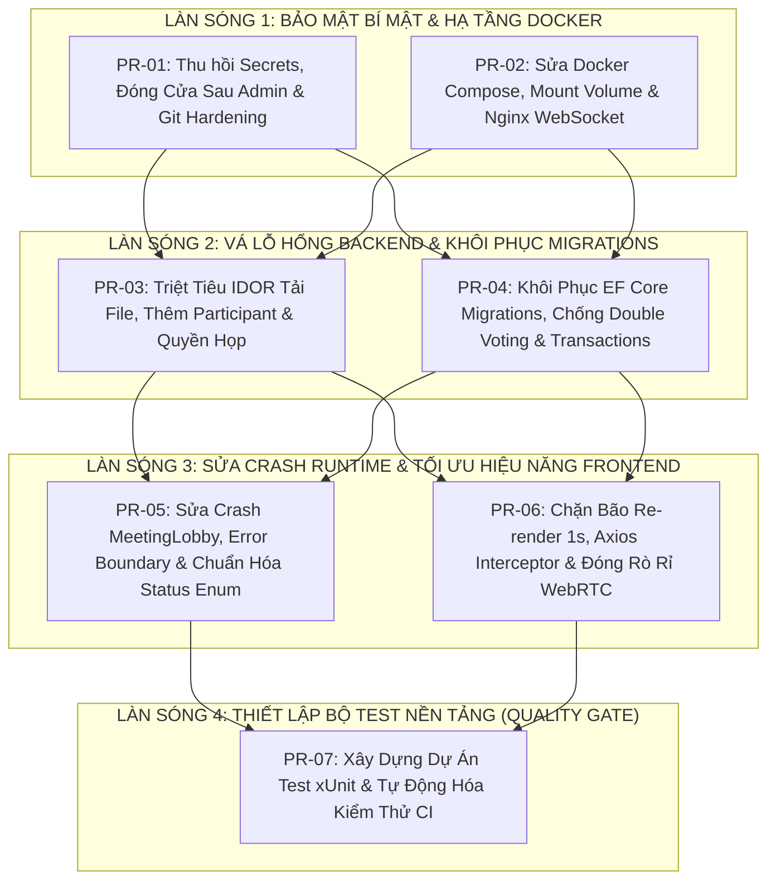

# KỊCH BẢN THỰC THI GIAI ĐOẠN 0 (PHASE 0 EXECUTION PLAYBOOK)
**Dự án:** Paperless Meeting System (`Project_3`)  
**Ngày lập:** 21/11/2026  
**Vai trò:** Lead Systems Architect & Orchestrator  
**Mục đích:** Hướng dẫn chi tiết từng gói công việc (Pull Request / Task) cho Phase 0, kèm sẵn các câu lệnh kiểm thử độc lập và **Subagent Prompts** sẵn sàng điều phối ngay khi được phê duyệt.

---

## 1. NGUYÊN TẮC THỰC THI (EXECUTION PRINCIPLES)
1. **Atomic Pull Requests:** Mỗi PR chỉ tập trung giải quyết 1 nhóm vấn đề gắn kết, không sửa lan man ngoài phạm vi.
2. **Verify Before Merge:** Mỗi PR phải có kịch bản test xác minh độc lập trước khi chuyển sang PR kế tiếp.
3. **No Regressions:** Không làm đứt gãy luồng đăng nhập, tạo cuộc họp và gọi video cơ bản hiện có.



---

## 2. CHI TIẾT CÁC GÓI THỰC THI (PULL REQUEST BLUEPRINTS)

---

### 📦 PR-01: Thu Hồi Secrets, Đóng Cửa Sau Admin & Git Hardening
- **Trạng thái:** ✅ COMPLETED (Đã thực thi & xác minh)
- **Mức độ ưu tiên:** `P0 - Critical`
- **Mục tiêu:** Loại bỏ hoàn toàn thông tin nhạy cảm khỏi git, bảo vệ CSDL, và đóng endpoint đăng ký Admin công khai.
- **Tệp tin tác động:**
  - `BE/Paperless_Meeting/appsettings.json`
  - `BE/Paperless_Meeting/Controllers/Auth/AuthController.cs`
  - `BE/Paperless_Meeting/Program.cs`
  - `.env.example` (Tạo mới)
  - `.gitignore` (Gốc, BE, FE)

#### Các bước thực hiện chi tiết:
1. **Xóa Secrets Trong `appsettings.json`:**
   - Thay giá trị `ConnectionStrings:DefaultConnection` bằng chuỗi mặc định rỗng hoặc placeholder local.
   - Thay `Jwt:Key` bằng placeholder: `"CHANGE_THIS_IN_PRODUCTION_ENV_VARIABLE"`.
2. **Tạo `.env.example`:**
   ```bash
   POSTGRES_USER=postgres
   POSTGRES_PASSWORD=your_secure_password_here
   POSTGRES_DB=paperless_meeting
   JWT_SECRET_KEY=generate_a_random_base64_string_at_least_32_chars_long
   JWT_ISSUER=paperless_meeting_api
   JWT_AUDIENCE=paperless_meeting_client
   ```
3. **Cập nhật `Program.cs`:**
   - Đảm bảo đọc `builder.Configuration.GetConnectionString("DefaultConnection")` và `builder.Configuration["Jwt:Key"]` ưu tiên từ Environment Variables.
   - Bổ sung kiểm tra khởi động (Fail-fast check): Nếu `Jwt:Key` có độ dài < 32 ký tự, ném ngoại lệ dừng ứng dụng ngay khi khởi động.
4. **Đóng Endpoint Admin Public trong `AuthController.cs:32`:**
   - Thêm `[Authorize(Roles = "SuperAdmin")]` lên trên `[HttpPost("register/admin")]` hoặc comment out toàn bộ endpoint này.
5. **Dọn dẹp Git:**
   - Xóa bỏ thư mục `BE/Paperless_Meeting/obj/` và các file test uploads khỏi Git tracking (`git rm -r --cached BE/Paperless_Meeting/obj/`).

#### Kịch bản kiểm thử độc lập (Verification):
- Dùng Postman/curl gửi `POST /api/Auth/register/admin` mà không truyền Bearer token -> Kết quả mong đợi: `401 Unauthorized` hoặc `404 Not Found`.
- Chạy `git status` -> Không còn file `.dll`, `.exe` hay `Uploads/` trong danh sách theo dõi.

#### Prompt Kích Hoạt Subagent:
```markdown
Hãy thực thi PR-01: Thu hồi Secrets, Đóng Cửa Sau Admin & Git Hardening.
1. Mở BE/Paperless_Meeting/appsettings.json, xóa sạch chuỗi kết nối Render DB thật và JWT secret key plaintext, thay bằng placeholders an toàn.
2. Tạo file .env.example ở thư mục gốc chứa các biến mẫu.
3. Trong BE/Paperless_Meeting/Controllers/Auth/AuthController.cs:32, thêm [Authorize(Roles = "SuperAdmin")] cho endpoint register/admin.
4. Thêm fail-fast validation độ dài JWT Key trong Program.cs.
5. Cập nhật các file .gitignore để không bao giờ theo dõi bin/, obj/, Uploads/, và .env.
```

---

### 📦 PR-02: Sửa Docker Compose, Mount Volume & Nginx Reverse Proxy
- **Trạng thái:** ✅ COMPLETED (Đã thực thi & xác minh)
- **Mức độ ưu tiên:** `P0 - Critical` & `P1 - High`
- **Mục tiêu:** Đảm bảo `docker compose up --build` chạy thành công, không mất file khi container restart, và thông luồng WebSocket cho SignalR.
- **Tệp tin tác động:**
  - `docker-compose.yml`
  - `FE/nginx.conf`
  - `FE/Dockerfile`
  - `BE/Paperless_Meeting/Dockerfile`
  - `.dockerignore` (Gốc, BE, FE)

#### Các bước thực hiện chi tiết:
1. **Sửa `docker-compose.yml`:**
   - Sửa dòng 29: `build: ./FE/FE` -> `build: ./FE`.
   - Bổ sung persistent volume cho backend:
     ```yaml
     services:
       backend:
         volumes:
           - backend_uploads:/app/Uploads
         restart: unless-stopped
       frontend:
         restart: unless-stopped
       db:
         restart: unless-stopped
     volumes:
       postgres_data:
       backend_uploads:
     ```
2. **Cấu hình lại `FE/nginx.conf`:**
   - Thêm `client_max_body_size 500M;` trong `server block`.
   - Bổ sung định tuyến WebSocket cho SignalR:
     ```nginx
     location /meetinghub {
         proxy_pass http://backend:8080/meetinghub;
         proxy_http_version 1.1;
         proxy_set_header Upgrade $http_upgrade;
         proxy_set_header Connection "upgrade";
         proxy_set_header Host $host;
         proxy_set_header X-Real-IP $remote_addr;
         proxy_set_header X-Forwarded-For $proxy_add_x_forwarded_for;
         proxy_set_header X-Forwarded-Proto $scheme;
         proxy_read_timeout 86400s;
     }
     ```
   - Thêm các HTTP Security Headers (`X-Frame-Options`, `X-Content-Type-Options`).
   - Bật `server_tokens off;`.
3. **Hardening Dockerfile:**
   - Thêm `USER app` vào runtime stage của `BE/Paperless_Meeting/Dockerfile`.
   - Tạo file `.dockerignore` loại trừ `bin/`, `obj/`, `node_modules/`, `.git/`.

#### Kịch bản kiểm thử độc lập (Verification):
- Chạy lệnh: `docker compose build --no-cache` -> Build thành công 100%.
- Khởi động: `docker compose up -d` -> Kiểm tra `docker ps`, cả 3 service đều `Up`.
- Kiểm tra upload file 10MB -> Nginx không báo lỗi `413 Request Entity Too Large`.
- Khởi động lại backend (`docker compose restart backend`) -> Kiểm tra file đã upload trước đó trong `/app/Uploads` vẫn còn nguyên.

#### Prompt Kích Hoạt Subagent:
```markdown
Hãy thực thi PR-02: Sửa Docker Compose, Mount Volume & Nginx Reverse Proxy.
1. Mở docker-compose.yml, sửa đường dẫn build frontend thành ./FE.
2. Thêm named volume backend_uploads:/app/Uploads vào service backend và khai báo ở mục volumes.
3. Thêm restart: unless-stopped cho cả 3 services.
4. Mở FE/nginx.conf, thêm location /meetinghub hỗ trợ WebSocket Upgrade, thêm client_max_body_size 500M, server_tokens off, và các header an ninh.
5. Bổ sung USER app vào BE/Paperless_Meeting/Dockerfile.
6. Tạo các file .dockerignore cho root, BE và FE.
```

---

### 📦 PR-03: Triệt Tiêu IDOR Tải File, Thêm Participant & Quyền Họp
- **Trạng thái:** ✅ COMPLETED (Đã thực thi & xác minh)
- **Mức độ ưu tiên:** `P0 - Critical` & `P1 - High`
- **Mục tiêu:** Vá triệt để các lỗ hổng IDOR trên tài liệu và quyền truy cập cuộc họp; loại bỏ static file server nguy hiểm.
- **Tệp tin tác động:**
  - `BE/Paperless_Meeting/Program.cs`
  - `BE/Paperless_Meeting/Controllers/Meeting/DocumentsController.cs`
  - `BE/Paperless_Meeting/Controllers/Meeting/ParticipantController.cs`
  - `BE/Paperless_Meeting/Controllers/Meeting/MeetingsController.cs`
  - `BE/Paperless_Meeting/Services/Document/DocumentService.cs`

#### Các bước thực hiện chi tiết:
1. **Xóa Static File Server Trong `Program.cs:178-189`:**
   - Xóa bỏ đoạn mã `app.UseStaticFiles(new StaticFileOptions { ... RequestPath = "/files" })`. Toàn bộ file chỉ được tải qua Controller.
2. **Vá IDOR Tại `DocumentsController.DownloadDocument`:**
   - Trích xuất `currentUserId` từ JWT Token (`User.FindFirst(ClaimTypes.NameIdentifier)`).
   - Kiểm tra `document.MeetingId`: User hiện tại bắt buộc phải là Host hoặc có bản ghi trong bảng `MeetingParticipants` của meeting đó (hoặc có Role `Admin`). Nếu không thỏa mãn, trả về `Forbid()` (HTTP 403).
3. **Vá IDOR Tại `ParticipantController.AddParticipant`:**
   - Bổ sung kiểm tra `await IsHostOfMeetingAsync(meetingId, currentUserId)`. Chỉ Host hoặc Admin mới có quyền thêm người vào cuộc họp.
4. **Bảo Vệ Danh Sách Cuộc Họp Trong `MeetingsController`:**
   - Đặt `[Authorize(Roles = "Admin")]` cho `GetAllMeetings`.
   - Tạo endpoint mới: `GET /api/meeting/my-meetings` chỉ trả về các cuộc họp mà user hiện tại tham gia hoặc làm Host.
5. **Kiểm Tra Whitelist và Magic Bytes Trong `DocumentService.cs`:**
   - Whitelist phần mở rộng an toàn: `.pdf`, `.docx`, `.xlsx`, `.pptx`, `.png`, `.jpg`.
   - Kiểm tra 4 bytes đầu tiên của file stream (Magic Bytes) để xác thực định dạng thật trước khi lưu xuống đĩa.

#### Kịch bản kiểm thử độc lập (Verification):
- Đăng nhập User A, lấy Token A.
- Gọi `GET /api/Document/download/{documentId của User B}` -> Kết quả: `HTTP 403 Forbidden`.
- Thử đổi đuôi file `test.exe` thành `test.pdf` và upload -> Hệ thống từ chối với lỗi `HTTP 400 Định dạng tệp không hợp lệ`.

#### Prompt Kích Hoạt Subagent:
```markdown
Hãy thực thi PR-03: Triệt Tiêu IDOR Tải File, Thêm Participant & Quyền Họp.
1. Trong BE/Paperless_Meeting/Program.cs, xóa bỏ khối UseStaticFiles ánh xạ /files vào Uploads.
2. Trong DocumentsController.cs (DownloadDocument): Trích xuất currentUserId từ Claims, kiểm tra xem user có thuộc meeting chứa document này không. Nếu không, trả về StatusCode 403 Forbidden.
3. Trong ParticipantController.cs (AddParticipant): Bổ sung kiểm tra quyền Host trước khi thêm người.
4. Trong MeetingsController.cs: Giới hạn GetAllMeetings chỉ cho Admin; tạo endpoint GetMyMeetings cho người dùng thông thường.
5. Trong DocumentService.cs: Bổ sung whitelist extensions và kiểm tra magic bytes cho file tải lên.
```

---

### 📦 PR-04: Khôi Phục EF Core Migrations, Chống Double Voting & Transactions ✅ *(ĐÃ HOÀN THÀNH - 2026-11-21)*
- **Mức độ ưu tiên:** `P1 - High`
- **Mục tiêu:** Chuẩn hóa cơ chế nâng cấp CSDL, chống gian lận biểu quyết và đảm bảo tính toàn vẹn dữ liệu.
- **Tệp tin tác động:**
  - `BE/Paperless_Meeting/Program.cs`
  - `BE/Paperless_Meeting/Data/PaperlessMeetingDbContext.cs`
  - `BE/Paperless_Meeting/Services/Meeting/MeetingService.cs`
  - `BE/Paperless_Meeting/Controllers/Meeting/PollsController.cs`
  - `BE/Paperless_Meeting/Migrations/` (Sinh mới)

#### Các bước thực hiện chi tiết:
1. **Khôi Phục EF Core Migrations:**
   - Thay `db.Database.EnsureCreated()` trong `Program.cs:141` bằng `db.Database.Migrate()`.
   - Chạy lệnh: `dotnet ef migrations add InitialCreate` để sinh migration chuẩn theo 12 C# Models.
2. **Chống Double Voting Tại Cấp Độ Cơ Sở Dữ Liệu:**
   - Trong `PaperlessMeetingDbContext.cs`, thêm cấu hình Unique Index trong `OnModelCreating`:
     ```csharp
     modelBuilder.Entity<UserVote>()
         .HasIndex(uv => new { uv.PollId, uv.UserId })
         .IsUnique();
     ```
   - Trong `PollsController.SubmitVote`: Bọc logic kiểm tra và lưu vote trong database transaction hoặc bắt ngoại lệ `DbUpdateException` khi trùng lặp khóa duy nhất để trả về thông báo "Bạn đã biểu quyết rồi".
3. **Bọc Transaction Khi Tạo Cuộc Họp Trong `MeetingService.cs:74`:**
   - Bọc logic tạo cuộc họp và thêm Host Participant trong một `BeginTransactionAsync`. Nếu lưu Host thất bại, rollback toàn bộ cuộc họp.

#### Kịch bản kiểm thử độc lập (Verification):
- Khởi động backend trên một CSDL PostgreSQL mới tinh -> Bảng `__EFMigrationsHistory` được tạo tự động và nạp bản ghi `InitialCreate`.
- Dùng kịch bản gửi 10 HTTP POST đồng thời bỏ phiếu cho cùng 1 Poll -> Chỉ duy nhất 1 request thành công (200), 9 request còn lại trả về lỗi (400/409 Conflict), trong bảng `UserVotes` chỉ có đúng 1 dòng.

#### Prompt Kích Hoạt Subagent:
```markdown
Hãy thực thi PR-04: Khôi Phục EF Core Migrations, Chống Double Voting & Transactions.
1. Mở BE/Paperless_Meeting/Data/PaperlessMeetingDbContext.cs, cấu hình Unique Index cho UserVote theo cặp (PollId, UserId).
2. Xóa lệnh EnsureCreated() trong Program.cs:141, thay bằng db.Database.Migrate().
3. Chạy dotnet ef migrations add InitialCreate để sinh migration hoàn chỉnh.
4. Trong MeetingService.cs (CreateMeetingAsync): Sử dụng Database Transaction bọc 2 lệnh SaveChangesAsync.
5. Trong PollsController.cs (SubmitVote): Xử lý bắt DbUpdateException để chặn triệt để race condition gian lận biểu quyết.
```

---

### 📦 PR-05: Sửa Crash MeetingLobby, Error Boundary & Chuẩn Hóa Status Enum ✅ *(ĐÃ HOÀN THÀNH - 2026-11-21)*
- **Mức độ ưu tiên:** `P0 - Critical`
- **Mục tiêu:** Loại bỏ lỗi sập trắng trang khi Admin vào họp, bọc Error Boundary toàn app, và sửa lỗi bộ lọc cuộc họp.
- **Tệp tin tác động:**
  - `FE/src/App.jsx`
  - `FE/src/main.jsx`
  - `FE/src/components/ErrorBoundary.jsx` (Tạo mới)
  - `FE/src/contexts/AppContext.jsx`
  - `FE/src/pages/admin/MeetingDetailsPage.jsx`

#### Các bước thực hiện chi tiết:
1. **Sửa Crash Runtime Trong `App.jsx`:**
   - Xóa bỏ dòng 33: `<Route path="/meeting/:meetingId/lobby" element={<MeetingLobby />} />`.
   - Sửa dòng 111 trong `MeetingDetailsPage.jsx`: Chuyển hướng nút "Join Meeting" sang `/meeting/${meeting.id}/prejoin`.
   - Dọn dẹp các route trùng lặp và đưa `path="*"` xuống cuối cùng của danh sách routes trong `App.jsx`.
2. **Tạo `ErrorBoundary.jsx`:**
   - Xây dựng React Error Boundary hiển thị giao diện báo lỗi thân thiện kèm nút "Tải lại trang" và "Về trang chủ".
   - Bọc quanh component gốc trong `main.jsx`.
3. **Chuẩn Hóa Contract Status Enum Trong `AppContext.jsx:56`:**
   - Viết hàm normalize status:
     ```javascript
     const normalizeStatus = (status) => {
       if (!status) return 'not_started';
       const s = String(status).toLowerCase();
       if (s === 'ongoing' || s === '1') return 'ongoing';
       if (s === 'completed' || s === '2') return 'completed';
       if (s === 'postponed' || s === '3') return 'postponed';
       return 'not_started';
     };
     ```
   - Áp dụng vào mapping danh sách cuộc họp để hiển thị chính xác các tab "Đang diễn ra", "Đã kết thúc".

#### Kịch bản kiểm thử độc lập (Verification):
- Đăng nhập Admin, vào chi tiết cuộc họp, bấm nút "Join Meeting" -> Vào thẳng màn hình Prejoin, không còn lỗi `ReferenceError: MeetingLobby is not defined`.
- Tạo một cuộc họp có thời gian hiện tại -> Cuộc họp hiển thị chính xác ở tab "Đang diễn ra" trên trang chủ.
- Giả lập ném exception trong một component con -> ErrorBoundary bắt được và hiển thị màn hình fallback thay vì sập trắng toàn bộ ứng dụng.

#### Prompt Kích Hoạt Subagent:
```markdown
Hãy thực thi PR-05: Sửa Crash MeetingLobby, Error Boundary & Chuẩn Hóa Status Enum.
1. Trong FE/src/App.jsx: Xóa route /meeting/:meetingId/lobby, dọn dẹp các route thừa, đưa path="*" xuống cuối cùng.
2. Trong FE/src/pages/admin/MeetingDetailsPage.jsx:111: Sửa link Join Meeting trỏ về /meeting/${id}/prejoin.
3. Tạo FE/src/components/ErrorBoundary.jsx và bọc quanh AppContent trong FE/src/main.jsx.
4. Trong FE/src/contexts/AppContext.jsx:56: Chuẩn hóa hàm normalizeStatus xử lý chuỗi PascalCase từ BE ('Scheduled', 'Ongoing', 'Completed').
```

---

### 📦 PR-06: Chặn Bão Re-render 1s, Axios Interceptor & Đóng Rò Rỉ WebRTC ✅ *(ĐÃ HOÀN THÀNH - 2026-11-21)*
- **Mức độ ưu tiên:** `P1 - High`
- **Mục tiêu:** Chấm dứt re-render toàn app mỗi giây, tự động làm mới JWT token khi hết hạn, đóng kết nối WebRTC khi rời phòng.
- **Tệp tin tác động:**
  - `FE/src/contexts/AppContext.jsx`
  - `FE/src/components/LiveClock.jsx` (Tạo mới)
  - `FE/src/components/Header.jsx`
  - `FE/src/pages/LoginPage.jsx`
  - `FE/src/utils/api.js`
  - `FE/src/hook/useMeeting.js`

#### Các bước thực hiện chi tiết:
1. **Cách Ly Đồng Hồ Thời Gian Thực:**
   - Xóa bỏ `currentTime` và `setInterval` trong `AppContext.jsx`.
   - Tạo component `<LiveClock />` tự duy trì state cục bộ. Nhúng vào Header và LoginPage.
2. **Viết Lại `api.js` Với Axios Interceptor:**
   - Sử dụng thư viện `axios` (đã có trong `package.json`).
   - Thiết lập Request Interceptor tự gắn header `Authorization: Bearer <token>`.
   - Thiết lập Response Interceptor: Khi nhận mã 401, tạm giữ các requests vào hàng đợi, gọi API `POST /api/Auth/refresh-token` với Refresh Token từ `localStorage`.
   - Sau khi có Access Token mới -> Cập nhật `localStorage` và replay lại toàn bộ hàng đợi requests mà không điều hướng người dùng ra màn hình login.
3. **Đóng Rò Rỉ Bộ Nhớ WebRTC Trong `useMeeting.js`:**
   - Trong cleanup function của `useEffect` (dòng 715):
     ```javascript
     return () => {
       if (peersRef.current) {
         Object.values(peersRef.current).forEach(peer => {
           if (peer && typeof peer.close === 'function') peer.close();
         });
         peersRef.current = {};
       }
       if (localStreamRef.current) {
         localStreamRef.current.getTracks().forEach(track => track.stop());
       }
       if (connectionRef.current) {
         connectionRef.current.stop();
       }
     };
     ```
4. **Sửa Hardcode URLs:**
   - Đổi `http://localhost:5075/meetinghub` thành relative `/meetinghub`.
   - Đổi `http://localhost:5075/api` thành relative `/api`.

#### Kịch bản kiểm thử độc lập (Verification):
- Bật React DevTools Profiler -> Quan sát thấy các component `HomePage`, `Header`, `AdminLayout` đứng yên, không bị re-render liên tục mỗi giây.
- Xóa Access Token trong `localStorage` (chỉ để lại Refresh Token), thực hiện một hành động tải dữ liệu -> Request thành công và Access Token mới tự động được ghi lại.
- Vào phòng họp video, sau đó bấm nút "Rời phòng" -> Kiểm tra camera tắt hẳn đèn tín hiệu, không còn kết nối WebRTC ngầm trong `chrome://webrtc-internals`.

#### Prompt Kích Hoạt Subagent:
```markdown
Hãy thực thi PR-06: Chặn Bão Re-render 1s, Axios Interceptor & Đóng Rò Rỉ WebRTC.
1. Trong AppContext.jsx: Xóa bỏ currentTime và setInterval 1s. Tạo component LiveClock.jsx độc lập cho Header và LoginPage.
2. Viết lại FE/src/utils/api.js dùng axios instance với Interceptor hỗ trợ hàng đợi tự động refresh token khi gặp 401.
3. Trong FE/src/hook/useMeeting.js: Sửa cleanup function lặp qua peersRef.current đóng toàn bộ RTCPeerConnection và dừng media tracks.
4. Chuyển đổi toàn bộ SignalR hub URL và api URL hardcoded thành đường dẫn tương đối /meetinghub và /api.
```

---

### 📦 PR-07: Xây Dựng Dự Án Test xUnit & Tự Động Hóa Kiểm Thử ✅ *(ĐÃ HOÀN THÀNH - 2026-11-21)*
- **Mức độ ưu tiên:** `P3 - Quality Gate`
- **Mục tiêu:** Thiết lập bộ kiểm thử tự động nền tảng (0% -> 70% coverage cho các luồng nghiệp vụ cốt lõi đã vá).
- **Tệp tin tác động:**
  - `BE/Paperless_Meeting.sln`
  - `BE/Paperless_Meeting.Tests/` (Tạo project xUnit mới)

#### Các bước thực hiện chi tiết:
1. Tạo project `Paperless_Meeting.Tests`:
   ```bash
   dotnet new xunit -o BE/Paperless_Meeting.Tests
   dotnet sln BE/Paperless_Meeting.sln add BE/Paperless_Meeting.Tests/Paperless_Meeting.Tests.csproj
   dotnet add BE/Paperless_Meeting.Tests reference BE/Paperless_Meeting/Paperless_Meeting.csproj
   dotnet add BE/Paperless_Meeting.Tests package Moq
   dotnet add BE/Paperless_Meeting.Tests package FluentAssertions
   dotnet add BE/Paperless_Meeting.Tests package Microsoft.EntityFrameworkCore.InMemory
   ```
2. Viết các Unit & Integration Test Suites:
   - `AuthServiceTests.cs`: Test đăng nhập, mã hóa BCrypt, sinh Refresh Token, rotation token.
   - `DocumentSecurityTests.cs`: Test kiểm tra quyền truy cập tài liệu (người ngoài meeting bị chặn 403, người trong meeting được phép).
   - `PollConcurrencyTests.cs`: Test giả lập 10 calls đồng thời vote cho cùng 1 user (chứng minh chặn đứng double-voting).
   - `MeetingTransactionTests.cs`: Test tạo meeting lỗi participant -> Toàn bộ transaction bị rollback sạch sẽ.

#### Kịch bản kiểm thử độc lập (Verification):
- Chạy lệnh: `dotnet test BE/Paperless_Meeting.sln` -> Kết quả: 100% Passed.

#### Prompt Kích Hoạt Subagent:
```markdown
Hãy thực thi PR-07: Xây Dựng Dự Án Test xUnit & Tự Động Hóa Kiểm Thử.
1. Tạo project test xUnit Paperless_Meeting.Tests trong BE và thêm vào solution.
2. Cài đặt các package: Moq, FluentAssertions, Microsoft.EntityFrameworkCore.InMemory.
3. Viết bộ kiểm thử Unit & Integration Tests bao phủ AuthService, Document Security IDOR check, Poll Concurrency chống double-voting, và Transaction tạo Meeting.
4. Đảm bảo toàn bộ test cases chạy thành công với lệnh dotnet test.
```

---

## 3. CHECKLIST NGHIỆM THU TỔNG THỂ PHASE 0 (GO/NO-GO GATEWAY)

Trước khi chuyển sang Phase 1, toàn bộ checklist sau đây phải được tích xanh:
- [ ] Không còn bất kỳ secret nào trong mã nguồn Git (`git diff` kiểm tra kỹ).
- [ ] `docker compose up --build` chạy trơn tru cả 3 service.
- [ ] Endpoint `/api/Auth/register/admin` đã được khóa an toàn.
- [ ] Tải tài liệu qua API bắt buộc phải kiểm tra quyền thành viên cuộc họp (IDOR resolved).
- [ ] Nginx chuyển tiếp WebSocket SignalR thành công không bị gián đoạn.
- [ ] Toàn bộ cuộc họp hiển thị đúng tab phân loại trên trang chủ FE.
- [ ] Không còn hiện tượng re-render mỗi 1 giây trong React DevTools.
- [ ] Thoát khỏi cuộc họp WebRTC giải phóng 100% tài nguyên camera/micro và kết nối mạng.
- [ ] Bộ kiểm thử `dotnet test` vượt qua 100% test cases.

---
*Tài liệu này sẵn sàng được đưa vào thực thi ngay khi nhận được lệnh duyệt từ Tech Lead.*
